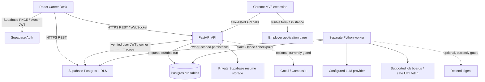

# JobPilot AI — Current Product, Implementation Status, and Roadmap

**Snapshot date: 17 November 2026**  
**Purpose:** One review document for the product as it exists in source, its verified hosted configuration, its unfinished release work, and the recommended implementation order. This is a repository and status-document review, not a new production audit.

## Executive overview

JobPilot AI is a personal, human-supervised job-search workspace. It brings job discovery, candidate profile and resume facts, matching, application preparation, outreach drafts, assisted form filling, and outcome tracking into one product. Its AI can organize and prepare work; the user remains responsible for confirming personal facts, approving communications, and submitting an application.

The six planned development sprints are implemented in the repository. The release candidate also includes the Career Desk redesign, an onboarding and overview flow, company research, writing templates, recommendation feedback, optional ranking experiments, hardened auth, and a proposed production setup. “Implemented” here means the relevant code and local verification exist; it does not mean every integration is enabled, production hosts are running, or every live workflow has been accepted.

Google and GitHub sign-in are now configured for the hosted **JobPilotAI** Supabase Auth project. The owner confirmed that both sign-in flows work locally on **13 November 2026**. Email magic links remain available. Production domain redirects, mail delivery, and release deployment still need setup and acceptance.

The last commit on `main` is `eb8c6d0` (Sprint 6), and `origin/main` points to that same commit in the captured Git state. The release candidate after that commit is a large set of modified and new, currently uncommitted files. The final release has not been pushed or deployed. One additive release migration is still unapplied to hosted Supabase projects.

## Product goals and operating principles

JobPilot is designed to reduce repetitive job-search work while keeping the candidate in control:

- Use the candidate’s resume and explicitly confirmed facts as the source for tailored materials.
- Explain match scores and hiring eligibility checks; treat them as guidance, not a promise of an interview or hiring outcome.
- Make source research and generated drafts reviewable and traceable.
- Keep user approval between AI preparation and email sending or employer submission.
- Show actual work from run events. A diagram of product capabilities must not imply that background agents are active.
- Keep account data private and prevent one account’s cached workspace from appearing in another account.
- Represent unknown outcomes as unknown rather than inventing zeroes, delivery, or employer acceptance.

## Main user journey

```mermaid
flowchart LR
  A[Landing page] --> B[Sign in: Google, GitHub, or email link]
  B --> C[Profile, resume, and preferences]
  C --> D[Follow boards and discover roles]
  D --> E[Review eligibility and match evidence]
  E --> F[Prepare resume and application drafts]
  F --> G[Review research, materials, and outreach]
  G --> H[Optional assisted form filling]
  H --> I[User submits application]
  I --> J[Record evidence, follow-ups, and outcomes]
  J --> K[Overview and analytics]
```

1. A job seeker lands on the public page and reviews the workflow demonstration and product boundaries.
2. They sign in with Google, GitHub, or an email magic link. The app returns to the same browser at `/login`, completes the Supabase PKCE callback, and routes authenticated users into the workspace.
3. The user imports a PDF or DOCX resume, reviews extracted facts, corrects the profile, confirms facts, and sets location, role, and schedule preferences. The original file and confirmed facts are account-scoped.
4. The user follows company ATS boards or supported job sources and scans them. The feed filters by role and stated hiring eligibility, shows match evidence, and lets the user save, skip, dismiss, or give explicit feedback.
5. A job can be opened in chat or prepared from the UI. The application workflow parses the job description, loads the user’s profile, tailors materials, checks PDF export, drafts a cover letter and outreach, saves a durable application record, looks for referral matches, and prepares possible form answers.
6. The user reviews the generated materials and any source research. Drafting does not send a message. Optional Gmail sending is a distinct, approval-controlled integration.
7. The Apply Queue and browser extension can help fill compatible forms and record what happened. Legal attestations and other sensitive questions stay with the user. The user submits on the employer’s site.
8. The product records observable submission and communication evidence, status changes, replies, and follow-ups. Overview and Analytics summarize measured activity and leave unavailable outcomes blank.

## Product features

### Public landing page

The landing page positions JobPilot as an **agentic career workspace** rather than a generic job board. It explains discovery, preparation, and user-controlled action, with the headline “Your next role. A coordinated effort.”

- Navigation links to the product sections, log in, and a start CTA.
- A workflow map previews how discovery, matching, preparation, and action connect. It is explicitly illustrative: it does not run a background job or real application.
- Supported board/source examples, feature explanations, FAQ, and conversion prompts explain the product before account creation.
- The page uses a dark green-charcoal field, large editorial typography, blue actions, restrained iris AI accents, and lime/amber status accents. Mobile navigation has an explicit open/close state and Escape recovery.
- The login page carries the same product identity and now offers Google, GitHub, and the existing email-link route.

### Authenticated workspace and navigation

All existing product routes remain available behind the shared application shell:

| Route | User-facing purpose |
|---|---|
| `/workspace` | Career Desk overview with real, account-scoped activity and next steps. |
| `/chat` | Copilot conversation, streaming progress, tool results, and workspace actions. |
| `/jobs` | Followed sources, scans, job-feed filters, match explanations, and drafting. |
| `/apply` | Prepared applications, browser-extension assistance, and submission evidence. |
| `/applications` | Application list/Kanban, filters, status, and history. |
| `/applications/new` | Add a job description or URL and start preparation. |
| `/applications/:id` | Resume, cover letter, outreach, research, approvals, and execution history. |
| `/profile` | Resume, candidate facts, experience, skills, preferences, and answer bank. |
| `/network` | Imported contacts and referral requests. |
| `/analytics` | Observed search and application outcomes with explicit denominators and gaps. |
| `/templates` | Private cover-letter, email, and DM writing preferences. |
| `/settings` | Account, theme, and integration settings. |

The desktop shell has persistent navigation and an account area. On narrow screens, navigation becomes a keyboard-contained drawer. Job discovery uses a list/detail pattern suited to narrow screens. Both light and dark themes use shared semantic tokens; loaders, empty/error states, keyboard focus, and reduced-motion behavior are considered in the implementation. This is not a full WCAG audit or visual certification.

### Candidate profile and resume

- Imports PDF/DOCX files up to 10 MiB and extracts structured candidate details, experience, skills, projects, and education.
- Shows extracted facts for user review and editing before matching or tailoring.
- Keeps base resume and tailored versions separate, and supports exporting rendered materials.
- Records fact provenance/confirmation against the source digest. Editing source content invalidates the associated confirmation; clients cannot invent facts through the confirmation endpoint.
- Maintains preferences and a private answer bank for repeated application questions, with sensitivity labels and explicit review.
- Resume content may be searched locally through an embedding/index cache; the canonical resume and application data stay in Supabase.

Fact confirmation means the user attested that a fact is accurate; it is not independent employment or credential verification. AI-generated prose still requires human review.

### Job discovery and matching

- Users follow and manage company boards and supported aggregators. Implemented source families include Greenhouse, Lever, Ashby, SmartRecruiters, Himalayas, and Remotive.
- A scan fetches openings, normalizes and deduplicates known posting identities, filters by user preferences, and saves owner-scoped postings.
- The feed supports matching, drafted, skipped, and dismissed views; title/company/skill filtering; fit threshold and remote filters; source management; and retry/restore actions.
- Matching combines job/resume text overlap with optional local semantic signals. The persisted match explanation contains score components/version, matched confirmed skills, eligibility checks, and caveats.
- Eligibility screening checks declared location/work-authorisation constraints, including the product’s India-focused rules. “Remote” alone does not establish India eligibility. Ambiguous job wording may be hidden or flagged for human review.
- Users can explicitly mark opportunities interested or not relevant and optionally provide reasons. Impressions are opt-in/visibility based; opening a job is not silently treated as dislike or training data.
- Baseline matching v2 remains the default. A prepared local CrossEncoder and offline BGE comparison are experiments only; ranking v3 is not promoted and no quality uplift is claimed.

Board access and page structure can change, and aggregation coverage is not universal. Deduplication prevents common repeat listings but cannot prove that every external requisition is the same or remains open.

### Copilot and application preparation

The chat assistant can read account-scoped workspace context, answer job-search questions, use supported tools, and stream progress. Its product actions share the same ownership checks and approval boundaries as the UI. Chat is not a replacement for reviewing saved materials.

The application preparation workflow is a LangGraph state graph with explicit stages:

1. Parse a job description and recheck eligibility.
2. Load the owner’s profile and base resume.
3. Tailor a resume using candidate evidence and calculate match details.
4. Check PDF rendering and surface a warning when output needs manual/browser export.
5. Draft a cover letter, email sequence, and LinkedIn messages.
6. Save the application and associated materials atomically with a recovery checkpoint.
7. Check candidate contacts for a potential referral without overwriting the user’s later edits.
8. Prepare suggested employer-form answers for review.

Private writing templates can influence later drafts. The new research feature accepts up to three user-supplied public URLs, safely fetches and records dated source excerpts, allows partial source failure, and can generate an unsaved cover-letter draft tied to that research. Users explicitly save or edit it.

### Application tracking, network, and analytics

- Applications can be listed, filtered, grouped, updated, archived, and tracked through statuses such as saved, applied, interviewing, offer, rejected, and archived.
- Materials and status are separate from provider evidence. A manually changed “sent” or “applied” status is not represented as a verified provider receipt.
- Contact import and management support referral matching and draft requests. A referral draft is not an outreach send.
- Analytics report events that the product can observe: preparation, field completion, send acceptance, replies, follow-ups, and submission evidence. Delivery, reading, interviews, offers, and employer acceptance remain unknown until supported by evidence.
- Recommendation snapshots, impressions, and usage counters are intended to be retained and pruned under an approved policy; no automatic retention schedule has been configured.

### Gmail, recruiter research, and digests

The code includes a supervised Gmail workflow, mailbox ownership checks, immutable/frozen sender and message snapshots, send approval, provider receipts, reply sync/review, bounce and uncertain-send handling, and a Resend-backed digest path. Hunter/recruiter enrichment and source research have integration/configuration requirements.

These application integrations are **not equivalent** to the user connecting Supabase through the ChatGPT Composio plugin. The backend still needs its own approved Composio/Gmail/Hunter/Resend configuration and provider acceptance. The current Render blueprint keeps mailbox and send flags disabled. No real recruiter email was sent during release implementation, and a message accepted by Gmail/Resend does not prove delivery or reading.

### Apply Queue and Chrome extension

The Manifest V3 extension connects to configured JobPilot web/API origins, checks the current application context, reads compatible application fields in the page, requests saved/AI-assisted answer suggestions, fills fields for the user to inspect, and records workflow observations. It has explicit origin allowlists, constrained message passing, isolated token handling, account-change invalidation, and a bounded retry outbox.

It does not guarantee compatibility with all sites. Native submission events and common multi-step forms are supported; arbitrary AJAX-only buttons, cross-origin frames, unusual controls, localized confirmation text, or server-side upload rejection may require manual steps. Legal agreements and high-impact attestations remain manual. **The user performs the final submit action.**

## Technology stack

| Layer | Current implementation |
|---|---|
| Web client | React 19, TypeScript, Vite 6, React Router 7, Tailwind CSS 4 tooling, Radix UI primitives, Lucide icons. |
| Client state | TanStack Query for server/cache state; Zustand for small UI/auth state; a new QueryClient and workspace boundary on account change. |
| Auth/data client | Supabase JS Auth using PKCE. Browser gets only the public Supabase key; service-role access stays in backend configuration. |
| API | Python 3.12, FastAPI, Pydantic settings/models, Uvicorn, versioned `/api/v1` routers. |
| AI/workflows | LangGraph `StateGraph` for application preparation and LangChain provider adapters for Groq/OpenAI/Anthropic. Provider selection is configuration-driven; production validation requires a configured provider. |
| Persistence | Supabase Auth, PostgreSQL, Storage and RLS. PostgreSQL also stores durable run state, stage checkpoints, events, leases, usage receipts, feedback, and research when the newest migration is applied. |
| Search/indexing | Local MiniLM embeddings are prepared for offline use. Chroma is used as an in-process cache, not a network server or durable source of truth. |
| Resume/document handling | `pypdf`, `python-docx`, Jinja2 templates, WeasyPrint, Pango/HarfBuzz and installed fonts for PDF output. |
| Background execution | A separate Python worker claims PostgreSQL jobs. Durable production mode does not need a Redis/Celery broker; those packages/legacy Compose files remain in the repository. |
| Browser extension | Chrome Manifest V3, JavaScript content scripts/background/popup, Chrome storage and Playwright browser checks. |
| Hosting definition | Render blueprint for Docker API, Docker worker, and static frontend. `autoDeploy: false`. No live Render deployment is recorded. |
| Verification/CI | Python regression and SQL harnesses, Node frontend tests, Playwright, extension tests, pinned GitHub Actions, dependency and Linux-image gates. Remote CI has not run for the current uncommitted release candidate. |

Version ranges and locks are in `frontend/package.json`, npm lockfiles, `backend/requirements.lock`, and the Dockerfile. The optional `requirements-ml.txt` is a separate experiment environment and is not part of the default production dependency set.

## System architecture and key decisions

### Security and account isolation

- Browser authentication is delegated to Supabase Auth. New social/email auth uses PKCE and a fixed same-origin `/login` callback; no arbitrary external `next` URL is honored.
- The API verifies JWT signature with an explicit HS256/ES256/RS256 allowlist, issuer/audience/expiry and user UUID. Production mode also checks the live Supabase session ID.
- Every business row and long-running run is tied to an owner. RLS and API ownership checks are both used; service-role credentials are restricted to backend processes.
- WebSocket credentials are sent in the first frame (with a timeout/size bound), not the URL. Durable streams authorize the run owner and revalidate during long-lived activity.
- The frontend partitions chat storage by Supabase user ID, discards account-specific cached state on account change, aborts stale work, and ignores late results from a prior account.
- Job-description URL fetching checks scheme/port, resolves and rejects non-public addresses, revalidates redirects, binds the approved IP while preserving the host/TLS name, and enforces content/size/deadline limits to reduce SSRF risk.
- Resume and multipart upload limits validate size and document/archive structure before parsing. The extension applies exact-origin and top-frame checks.
- Private operation metrics are token-gated. Production startup rejects unsafe configuration; readiness checks database schema and worker health in durable mode.

These are implemented defenses and test targets, not a third-party penetration test or blanket certification.

### Durable runs and recovery

PostgreSQL is deliberately the queue and system of record, so the product avoids a second broker for release-mode jobs. `agent_runs`, `agent_run_events`, and `agent_run_locks` hold owner, request identity, stage, status, attempts, result, checkpoint and lease state. API requests enqueue; the worker claims with `FOR UPDATE SKIP LOCKED`, renews a lease from a heartbeat thread, checkpoints stages and commits through fenced database functions.

Idempotency keys bind a request to its owner and inputs. Run and event reads are owner-scoped. Retries reuse completed checkpoints and stop after bounded attempts. Application/material saving is atomic and idempotent. An external model call can repeat if a process dies after the provider returns but before the stage checkpoint; this can incur repeat provider cost even though the final saved application is protected from duplication.

`EXECUTION_MODE=inline` remains a development/backward-compatible default in the source config. Release mode is intended to set `EXECUTION_MODE=durable` on both API and continuously running worker. Do not mix modes against one live queue.

### Matching and AI strategy

Eligibility remains a hard filter and a candidate must pass the stated conditions before a ranking experiment can reorder a shortlist. Baseline v2 is the stable product behavior. Optional reranking is local, prepared ahead of time, and can fall back to the baseline. BGE/CrossEncoder comparisons are offline evaluation tools. The roadmap requires a suitable independently labeled dataset, diverse groups, ranking metrics, eligibility checks, and host memory/latency review before proposing promotion. LambdaMART, bandits, clustering, pgvector, and additional AI services are future work only if measured needs justify them.

## Database and environment status

- **Primary project:** hosted Supabase project named **JobPilotAI**. It remains the production-intended database and is also the database the owner used for local app testing. Local `.env` values were not changed during the OAuth configuration work.
- **Separate project:** `test-project` remains for isolated migration/SQL trials and fixtures; it is not the primary app database.
- The repository contains **19** ordered SQL migration files. The Oct. 30 rollout record documents Sprint 1–6 database changes on JobPilotAI, checksums for 14 original public tables, and no change to existing user rows from that rollout.
- The newest file, `20261107152821_release_recommendations_research.sql`, is a release-candidate migration and is documented as **not applied** to either hosted project. It adds release recommendation/feedback and impression storage, usage controls/receipts, company research, writing templates, session-validation support, and supporting RPCs/indexes/policies.
- Source tests, the release SQL suite, and a disposable PostgreSQL 17 environment cover this migration. That is not evidence that JobPilotAI has the schema or a verified provider backup restore.
- Before applying it, reconcile the recorded Supabase migration-version mapping to the actual JobPilotAI schema/history, verify a provider backup/restore into an isolated project, review SQL/advisors, and take the approved release path. Never blindly replay earlier creation migrations or repair history based only on local filenames.
- The live Auth project was read-only checked on 13 Nov: Auth healthy; Google, GitHub, and email available; local `localhost:5173/login` and `127.0.0.1:5173/login` returns allowlisted; email still enabled. The owner separately confirmed Google and GitHub sign-in works locally.
- Supabase `site_url` is still `http://localhost:5173`. No real production frontend domain has been supplied/configured in Auth or Google/GitHub provider consoles.

## Current delivery and release status

| Area | Status on 17 Nov 2026 | What that status means |
|---|---|---|
| Sprint 1 — security foundation | **Implemented** | WebSocket owner checks, account isolation, SSRF protections, upload bounds, extension allowlists, and security migrations are in source. Production gates and formal audit remain. |
| Sprint 2 — durable orchestration | **Implemented; rollout acceptance pending** | Queue, leases, checkpoints, retry and worker are in source; Sprint 2–6 migrations are recorded on JobPilotAI. The release API/worker are not deployed or confirmed running. |
| Sprint 3 — matching v2 and identity vault | **Implemented** | Facts, provenance, eligibility, explanations, semantic fallback, and deduplication are present. Independent ranking-quality evidence and two-account acceptance are still limited. |
| Sprint 4 — Gmail and recruiter outreach | **Code implemented; live integration gated** | Approval and receipt workflow exists. Backend Gmail/Composio/Hunter setup and real-send/reply acceptance are absent; send defaults are off. |
| Sprint 5 — supervised application execution | **Implemented; site-specific acceptance pending** | Apply Queue, extension, form suggestions, evidence, and replay protections exist. Universal employer-form support is not claimed. |
| Sprint 6 — validation and visibility | **Implemented** | Overview, onboarding, outcome definitions and operational visibility exist. External alerts, public operation and host capacity are unverified. |
| Career Desk UI/UX | **Implemented in source** | Landing, login, shared theme, overview, mobile navigation, job list/detail, and retained routes are in the release candidate. Human target-device and accessibility review remain. |
| Google/GitHub sign-in | **Live configured; owner-tested locally** | Providers are enabled on JobPilotAI; public settings and first redirects were independently checked; owner reports both flows work. Production-domain redirects and multi-account linking/isolation are not accepted yet. |
| Database release additions | **Pending** | Newest additive release migration is not applied to either hosted project. |
| Backend/frontend hosting | **Not deployed** | Render blueprint exists with three services and auto-deploy disabled. No release deployment or production domain is recorded. |
| Release candidate Git state | **Review required** | `main` and `origin/main` match at `eb8c6d0`; substantial later changes remain uncommitted/unpushed. Carefully select release files; do not stage every untracked/local artifact. |

### Recorded verification and its limits

The release-readiness record dated 7 November records: **338 backend tests passed** in a clean release environment; **35 frontend checks passed**; **14 application browser workflows passed**; **7 extension unit checks and 15 Chromium extension workflows passed**; TypeScript/Vite production build passed; frontend and extension npm audits returned zero findings; 19 migrations and seven SQL suites passed on disposable network-isolated PostgreSQL 17; worker-kill/lease-expiry/checkpoint recovery produced exactly one persisted application/material set; and a synthetic database archive was restored into a separate local database.

Those are historical local/fixture checks, not a claim that they were rerun on 17 November or by remote CI. Provider requests were mocked for many test suites. The owner’s local OAuth success is real provider acceptance; Gmail send, Hunter lookup, production SMTP delivery, deployed Linux PDF rendering, live form submission, and production load are not included in that acceptance.

The Linux release-image build/smoke was **not completed** because package/image downloads timed out. The current dependency review documents four Chroma 1.5.9 advisories affecting Chroma server paths, with an exception expiring **7 December 2026**. JobPilot runs Chroma in-process and does not run its HTTP server, but the exception must be re-reviewed or removed before expiry; do not describe the dependency state as vulnerability-free. Remote GitHub Actions CI has not run for the current unpushed candidate, and branch protection is not configured.

## Deployment strategy

The repository describes a **Render** deployment with three coordinated services:

1. **Static frontend:** `frontend/` built with `npm ci && npm run build`, client-side route rewrites to `index.html`, immutable asset caching, no-cache HTML, and security headers.
2. **FastAPI API:** Docker image from `backend/Dockerfile`, health/readiness endpoint `/ready`, HTTPS exact-origin CORS, production startup validation, and no auto-deploy.
3. **Continuous Python worker:** same Docker image and release revision, started with `python -m app.workers.runner`, sharing the backend environment and durable PostgreSQL execution mode.

The image uses pinned Python 3.12 Bookworm and uv digests, installs locked dependencies, includes WeasyPrint native libraries/fonts and a prepared MiniLM cache, and runs as non-root. Production mode expects HTTPS origins, separate high-entropy server secrets, valid Supabase credentials, an AI provider, usage limits, and durable execution. The frontend build gets only public Supabase/API/WebSocket settings; backend service-role and integration credentials never belong in frontend environment variables.

Rollout order should be: release code review and CI/image gates → verified backup and migration-history reconciliation → approved additive migration and advisors → deploy matching API and worker revision with auto-deploy still controlled → verify `/ready`, worker heartbeat and database access → deploy frontend with real HTTPS origins and matching OAuth redirect allowlists → run acceptance checklist → enable optional integrations only after their own approval → record deployment revision and rollback target.

Rollback should stop new durable intake, allow/drain current runs where possible, preserve queued durable work and database state, redeploy the last known-good API and worker together, and roll back frontend independently. Do not revert a database migration or switch execution modes without a migration-specific recovery plan.

## Recommended future implementation plan

The six feature sprints are complete. The next work should close release and operational gaps before adding another product sprint.

### Phase 0 — create a reviewable release boundary

- Inspect every modified and new file since `eb8c6d0`; identify generated `data/` and other local files and keep them out of the release unless deliberately reviewed.
- Confirm the intended commit set, ensure `PROJECT_ANALYSIS.md` and `assets/portfolio/` remain ignored, check secrets and environment files are excluded, and make sure design/release docs agree on current OAuth and migration status.
- Run the declared local release checks from the clean environment and retain their dated results; do not imply that remote CI passed before it has run.
- Resolve any defects and review exact changed files before the final push, as requested by the owner.

### Phase 1 — close security, dependency, and database gates

- Complete a Linux Docker image build and `backend/scripts/check_image.py` smoke on a reliable runner; verify non-root execution, read-only root filesystem, network restrictions, PDF rendering, offline model cache, health behavior, and resource bounds.
- Re-run dependency assessment and remove/upgrade the four reviewed Chroma server-path exceptions or document an approved, time-bounded disposition before **7 December 2026**. Keep Chroma in-process.
- Verify the JobPilotAI provider backup can be restored into an isolated project. Reconcile migration records and actual schema, apply only the missing release migration through the reviewed procedure, run its SQL suite and Supabase advisors, and record the rollback plan.
- Review the pre-existing `set_updated_at` function search-path warning, disabled leaked-password protection, and other baseline advisories. Fix or explicitly accept each with a named owner and risk record.

### Phase 2 — configure production identity and runtime

- Select real frontend/API domains and configure exact Auth site URL, allowed returns, Google origins/redirects, GitHub callback, API CORS, WebSocket/SSE URLs, and extension origin allowlists.
- Configure custom Auth SMTP/sender and verify delivery, expiry, resend limits, logout and session revocation. Verify provider audience/restrictions, two accounts, and same/different-email identity behavior without exposing account data.
- Provision the three Render services or the chosen equivalent; use the same JobPilotAI environment and code revision for API and worker, set production flags and server-only secrets, and keep auto-deploy disabled until release approval.
- Measure CPU, memory, startup, model warm-up, PDF generation, scan latency, queue delay, connection behavior, concurrency, and recovery on the actual selected host.

### Phase 3 — accept optional integrations and supervised workflows

- Either launch with Gmail, Hunter and digest disabled, or configure backend Composio/Gmail identity verification, Hunter, and Resend credentials in the server’s secret store.
- If enabling email, use a specifically approved test recipient. Verify sender freeze, draft revision approval, provider receipt, reply sync, disconnect/revocation, bounce/unsubscribe stops, duplicate prevention, and ambiguous-send recovery. Never infer inbox delivery from provider acceptance.
- Test the extension against explicitly permitted test forms and real authorized origins. Cover native and dynamic fields, navigation, uploads/rejections, confirmation evidence, account switching, and manual handling of unsupported forms. The user remains the submitter.
- Exercise real AI generation and PDF rendering using a test profile. Check grounded resume facts, fallbacks, quoted research sources, saved templates, and account ownership.

### Phase 4 — launch readiness, review, and controlled rollout

- Add external uptime/readiness polling and test alert delivery; decide retention/deletion for source documents, mail snapshots, PDFs, run events, feedback, analytics, and provider backups.
- Publish and review privacy, terms, and contact information. Conduct a human keyboard, screen-reader, zoom, color-contrast, mobile, and light/dark pass. Automated fixture tests are not a substitute.
- Require remote CI and appropriate branch protection; capture immutable release commit/image identifiers and a rollback target.
- Present the exact reviewed candidate and outstanding acceptance results to the owner before final push and deployment. Deploy only after that release review.

### Phase 5 — post-launch product improvements

- Establish baseline product metrics (successful onboarding, time to first relevant match, preparation completion, user correction rate, and confirmed workflow outcomes) without treating clicks or opens as positive labels.
- Collect consented and privacy-reviewed independent relevance labels. Keep v2 ranking until evaluation has enough independent groups and the candidate model passes ranking, eligibility, latency, memory, fairness, and rollback checks. No automatic training or promotion.
- Improve support for additional boards and complex forms only from measured demand and regression fixtures; keep unsupported-site messaging honest.
- Add identity-management UX, deletion/export controls, and retention automation once policy and legal requirements are approved.
- Consider LambdaMART, bandits, clustering, pgvector, or new integrations only when evidence shows the simpler baseline is insufficient.

## Decisions and explicit non-goals

| Decision | Reason and practical limit |
|---|---|
| Supabase Postgres is canonical data and durable queue | One durable system for owner data, checkpoints and events; no new Redis broker in production mode. Existing Redis/Celery files remain legacy/optional. |
| LangGraph expresses the known multi-step preparation flow | Stages are inspectable and checkpointable. The UI does not claim a swarm of autonomous agents. |
| Chroma is a rebuildable local cache | It is not the source of truth and no network Chroma service is run. |
| User review gates external actions | Drafts do not send automatically; the extension does not silently submit applications. |
| v2 matching stays the baseline | v3/reranking has no independent quality evidence sufficient for promotion. |
| Research requires supplied URLs and citations | Source-bound context makes drafts inspectable; fetched public pages can still be incomplete or stale. |
| Google/GitHub are identity providers only | OAuth scopes are limited to sign-in identity; Google sign-in does not connect Gmail and GitHub sign-in does not grant repository access. |

## Review checklist

- [ ] Every release file since the last commit has an intended purpose and reviewer.
- [ ] Local data, secrets, generated artifacts, ignored analysis/portfolio files are excluded.
- [ ] Remote CI and Linux image gates pass on the exact candidate commit.
- [ ] Chroma exception is resolved/re-reviewed before 7 Dec 2026.
- [ ] Hosted backup restore and migration history are reconciled; only the approved additive migration is applied.
- [ ] Auth SMTP, production return URLs, session/revocation, and two-account behavior are accepted.
- [ ] API and worker run the same durable revision and `/ready` reports healthy.
- [ ] Optional email, digest, and recruiter integrations are either explicitly disabled or separately accepted.
- [ ] Extension, real permitted forms, PDF output, alerts, retention/deletion, and privacy pages are reviewed.
- [ ] Product UI receives human accessibility/device review.
- [ ] Owner reviews the exact commit and deployment target before final push/deployment.

## Related source documents

- [README and local setup](README.md)
- [Sprint 1–6 implementation records](SPRINT_1_STATUS.md), [Sprint 2](SPRINT_2_STATUS.md), [Sprint 3](SPRINT_3_STATUS.md), [Sprint 4](SPRINT_4_STATUS.md), [Sprint 5](SPRINT_5_STATUS.md), [Sprint 6](SPRINT_6_STATUS.md)
- [Design system and UI decisions](DESIGN.md), [design research](DESIGN_RESEARCH.md)
- [Database rollout history](DATABASE_ROLLOUT_STATUS.md)
- [Release evidence and limitations](RELEASE_READINESS.md)
- [Remaining production setup](PRODUCTION_SETUP.md), [production gates](PRODUCTION_READINESS.md)
- [Deployment and rollback](DEPLOY.md), [operations runbook](OPERATIONS_RUNBOOK.md)
- [Dependency security assessment](DEPENDENCY_SECURITY.md)
- [Google/GitHub provider setup and acceptance](SOCIAL_LOGIN_SETUP.md)

