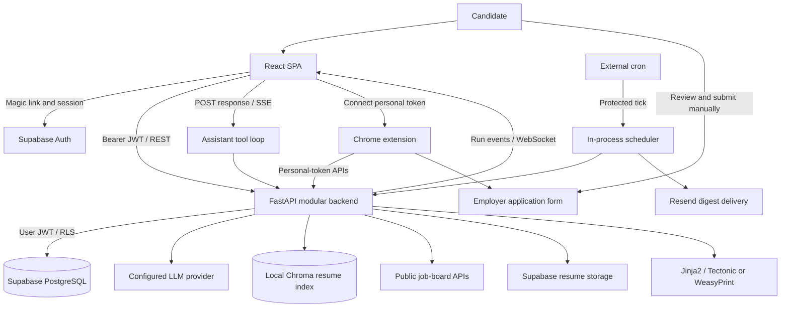
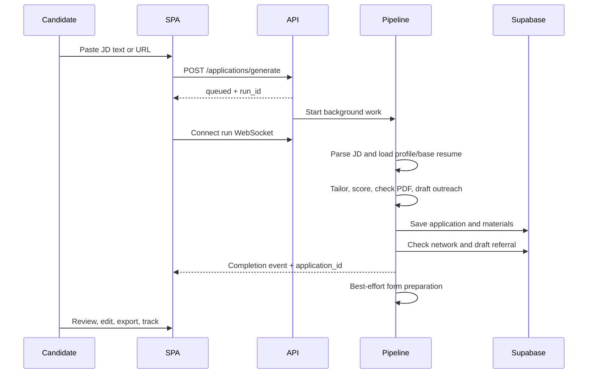

# JobPilot AI — Complete Project Analysis

**Analysis date:** 23 October 2026 (Asia/Calcutta)  
**Repository revision inspected:** `334253f` — `docs(deploy): document setup and configure Docker and Render hosting`  
**Scope:** Current checked-out source, frontend, backend, extension, database migrations, deployment configuration, tests, and project documentation.

## 1. Executive assessment

JobPilot is a working job-search assistance application with a conversational home screen, resume tailoring, application tracking, public job-board discovery, referral preparation, supervised form filling, and scheduled morning digests. Its strongest implemented workflow is turning a job description and an existing resume into an editable application package.

The project is best described as an **advanced functional prototype / early MVP with production deployment configuration**. That is an assessment of the code and checks, not an official release designation. It has substantially more functionality than a mockup, but several visible or documented capabilities remain incomplete, and its background execution model needs hardening for reliable multi-instance production use.

The product automates preparation and assists execution. It does not provide unattended end-to-end job submission. The extension fills fields, the candidate reviews and submits on the employer's website, and the candidate records submission in JobPilot. Cold outreach is drafted and tracked; the general email-send endpoint does not actually deliver mail. Morning digests have a separate implemented Resend integration.

### Verification performed for this report

| Check | Observed result |
| --- | --- |
| Backend regression suite | **156 passed**, four warnings, 39.76 seconds |
| Frontend production build | **Passed**: TypeScript followed by Vite bundling |
| Build tool reported | Vite **6.4.3** in the installed local environment |
| Frontend build warning | Supabase module is both statically and dynamically imported; dynamic imports do not isolate it into another chunk |
| Backend warnings | Starlette/httpx deprecation, legacy Chroma embedding-function configuration, deprecated Supabase client timeout/verify parameters |
| Live Supabase schema, RLS, and storage | Not verified against the hosted account |
| Live LLM, employer forms, email delivery | Not exercised |
| Current hosted deployment, DNS, logs, uptime | Not queried or established by this audit |
| Visual browser and accessibility testing | Not performed; UI analysis below derives from components and CSS |

No credentials are reproduced. Existing environment-file contents were not needed for the analysis. Existing documentation and untracked portfolio assets are preserved.

## 2. Product purpose and operating model

The application helps a job seeker maintain a reusable professional identity, identify suitable roles, tailor material for each role, find people they already know at target companies, and keep track of applications and follow-ups.

The main user is an individual candidate. Ownership filtering and Supabase RLS support multiple user accounts, but there is no implemented organization workspace, shared hiring team, billing system, administrator console, or enterprise tenancy model visible in the current source.

The job feed has a pronounced **India eligibility policy**: automated discovery requires affirmative evidence that a role accepts India-based candidates. This is applied beyond simply detecting the user's country. Broad regional labels such as APAC alone do not prove eligibility. This favors conservative filtering and can hide relevant roles when employers provide incomplete location data.

### Current implementation matrix

| Capability | Status | Important boundary |
| --- | --- | --- |
| Public landing page | Implemented | Compact marketing page with a static conversation example |
| Email magic-link authentication | Implemented | Supabase Auth and allowed redirect configuration required |
| Professional profile | Implemented | Personal details and structured base resume are saved separately |
| Structured resume editing | Implemented | Profile UI covers a subset of the complete resume schema |
| PDF/DOCX resume ingestion | Backend implemented | No upload control found in the current Profile page |
| JD parsing from text or URL | Implemented | URL fetching is plain HTTP/HTML extraction, without browser rendering |
| AI resume tailoring | Implemented | Full base resume plus optional semantic retrieval; can fall back to unchanged base content |
| ATS keyword score | Implemented heuristic | Keyword coverage, not an external ATS evaluation or hiring probability |
| PDF rendering/export | Implemented | Native dependencies needed; browser print is an alternative |
| Cover letter, three-email sequence, two LinkedIn drafts | Implemented | Drafts require editing and manual use |
| Application list/table and Kanban | Implemented | Status changes include optimistic UI updates |
| Chat assistant and tool cards | Implemented | Bounded tool loop; history resides in browser storage |
| Assistant approval proposals | Implemented | Selected edits apply only when the UI sends the approved mutation |
| Six public job-board integrations | Implemented | Four company ATSs plus two remote aggregators |
| Local job fit scoring and skip rules | Implemented | Some stored preference fields are not enforced by the matcher |
| Automatic drafting | Implemented, opt-in | Threshold, eligibility rules, daily cap, running backend required |
| LinkedIn network import and manual contacts | Implemented | Uses exported CSV/ZIP, not LinkedIn OAuth or live graph access |
| Referral matching and message drafts | Implemented | User sends the message and records outcome |
| Apply queue | Implemented | Preparation queue, not proof of employer submission |
| Chrome autofill extension | Implemented | Unpacked Manifest V3 extension; browser/form compatibility needs live verification |
| Scheduled scan and morning digest | Implemented | Service-role key, Resend setup, and an awake server needed |
| Analytics and skill-gap analysis | Implemented | Metrics depend on locally recorded statuses and outreach metadata |
| Template library management | Placeholder | Buttons have no create/edit persistence workflow |
| Recruiter/HR enrichment | Placeholder | Contact endpoints return empty data; research agent raises `NotImplementedError` |
| General cold-email sending/history | Placeholder | Send route returns a message; history returns an empty collection |
| Autonomous tracker agent | Placeholder class | Actual tracking is implemented through ordinary API/service logic |
| Celery workers, Redis task queue | Not wired into runtime | Dependencies and Compose Redis service exist |
| LangGraph workflow execution | Not wired into runtime | Dependency exists; actual orchestration is Python control flow |
| Sentry/LangSmith instrumentation | Not initialized in inspected app | Declared dependencies do not establish active monitoring |

## 3. Repository structure and responsibility boundaries

```text
JobPilot AI/
├── frontend/
│   ├── src/pages/                 Public and authenticated screens
│   ├── src/components/agent/      Conversation, briefing, cards, workspace
│   ├── src/components/applications/ Resume, diff, outreach, referrals
│   ├── src/components/profile/    Preferences and answer bank
│   ├── src/components/layout/     Route guard and navigation shell
│   ├── src/components/ui/         Reusable visual primitives
│   ├── src/hooks/                 Server queries, mutations, stream handling
│   ├── src/agent/                 Chat protocol client and persisted store
│   ├── src/stores/                Auth and general UI state
│   └── src/lib/                   API client, Supabase, tokens, theme, storage
├── backend/
│   ├── app/api/v1/                HTTP interface and authorization entry points
│   ├── app/agents/                Assistant and document-generation logic
│   ├── app/services/              Integrations and domain services
│   ├── app/models/                Pydantic domain/request schemas
│   ├── app/resume_engine/         Content mapping, templates, renderers, validation
│   ├── supabase/migrations/       Incremental SQL migrations
│   ├── tests/                     Mocked backend regression suite
│   ├── test_supabase.py           Separate diagnostic script
│   ├── test_vector_store.py       Separate diagnostic script
│   ├── Dockerfile                Production API container
│   └── docker-compose.yml        Local API and Redis topology
├── extension/                    Chrome service worker, popup, content scripts
├── assets/                       Existing portfolio-related assets
├── render.yaml                   API and static frontend blueprint
├── README.md                     Current project/setup overview
├── DEPLOY.md                     Hosting and operational walkthrough
└── JobPilot_AI_Full_Documentation.md Existing broader documentation
```

This is a single repository with separately built frontend and backend applications and a separately installed browser extension. There is no root application package/workspace configuration coordinating builds. A root package lock exists locally but is ignored; the frontend lockfile is the relevant JavaScript build lockfile.

## 4. Technology stack

### 4.1 Frontend

Version ranges below describe `frontend/package.json`; they are not claims that those are the exact installed versions.

| Layer | Technology / declared range | Role |
| --- | --- | --- |
| UI runtime | React / React DOM `^19.0.0` | Component rendering and hooks |
| Language | TypeScript `^5.5.2` | Static typing and build checking |
| Build/dev | Vite `^6.0.0`, React plugin `^4.3.0` | Development server and production bundles |
| Styling | Tailwind CSS and Vite plugin `^4.0.0-alpha.18` | Utility classes plus CSS theme tokens |
| Routing | React Router DOM `^6.23.1` | Browser routes and redirects |
| Server-state cache | TanStack React Query `^5.45.1` | Fetching, mutations, invalidation, optimistic rollback |
| Client-state store | Zustand `^4.5.2` | Auth/UI/chat state |
| Auth client | Supabase JS `^2.43.4` | Sessions and magic links |
| UI primitives | Radix Slot `^1.0.2`, Tabs `^1.0.4` | Composition and tab behavior |
| Icons | Lucide React `^1.53.0` | Consistent outline iconography |
| Class helpers | CVA, clsx, tailwind-merge | Component variants and class composition |
| HTTP | Browser `fetch` | JSON, multipart, binary PDF, streaming requests |
| Progress transports | WebSocket and fetch-based SSE reader | Generation progress and assistant responses |

There is no Next.js, server-side React renderer, frontend API server, or frontend test framework configured in the package scripts. Scripts are `dev`, `build`, and `preview`.

TypeScript targets ES2023, uses bundler module resolution and strict checking, and enables unused-local/parameter checks. Some form data still uses `any`, especially in Profile. `@/` resolves to `frontend/src` in both TypeScript and Vite.

### 4.2 Backend and storage

| Layer | Technology | Role |
| --- | --- | --- |
| Runtime target | Python 3.12 in Docker | API execution |
| HTTP server | FastAPI + Uvicorn | Async endpoints, dependencies, OpenAPI, WebSocket |
| Schemas/settings | Pydantic v2, pydantic-settings, dotenv | Structured outputs and environment configuration |
| Primary managed platform | Supabase | PostgreSQL access, Auth, optional resume file storage |
| AI abstraction | LangChain provider wrappers | Anthropic, OpenAI, Groq chat models and structured output |
| Embeddings/vector index | ChromaDB | Local persistent semantic resume retrieval |
| Embedding alternatives | Hugging Face API, OpenAI | Configurable remote embedding strategies |
| Resume extraction | pypdf, python-docx | PDF text and DOCX paragraph extraction |
| Templates | Jinja2 | HTML and LaTeX document templates |
| PDF | WeasyPrint; optional Tectonic | Server document generation with fallback |
| External HTTP | httpx | Job boards, JD pages, email provider, JWKS |
| HTML text processing | BeautifulSoup | Extract readable descriptions |
| JWT | python-jose + cryptography | Supabase access-token validation |
| Email | Resend HTTP integration | Morning digests |
| Time zones | zoneinfo + tzdata | Per-user digest schedule |
| Tests | pytest + pytest-asyncio | Backend regression suite |

`backend/requirements.txt` primarily uses minimum-version constraints rather than a fully pinned dependency lock. This permits builds to resolve different versions over time. Celery, Redis, LangGraph, Sentry, and LangSmith are listed but are not evidence of active runtime use. Hunter and Adzuna configuration fields likewise do not establish implemented integrations.

### 4.3 Browser extension

The extension is JavaScript/HTML/CSS with no separate build pipeline. It uses Chrome Manifest V3, a background service worker, `chrome.storage.local`, active-tab access, and script injection. Installation is through Chrome developer mode, not a verified Web Store release.

## 5. System architecture and data flow



The backend is a **modular monolith**: one FastAPI process holds API routes, domain services, generation agents, scheduler, caches, and stream state. The frontend, API, Supabase, external providers, and extension are distinct deployment/trust boundaries, but the backend services are not independently deployed microservices.

### 5.1 Important design patterns

| Pattern | Concrete implementation | Implication |
| --- | --- | --- |
| Layered application | Routes → agents/services → Supabase/providers/renderers | Most business logic is separated from screens and transport |
| Dependency injection | FastAPI auth dependencies produce `CurrentUser` or extension identity | Shared validation and user-scoped access |
| Explicit orchestration | `run_agent_pipeline` calls stages in order | Easy to follow, but no durable graph/checkpoint engine |
| Adapter/strategy | Provider clients, board fetcher registry, embedding choices, PDF renderer choice | External implementations share a common application interface |
| Structured AI output | Pydantic Resume and JDAnalysis schemas | Output shape is constrained; factual accuracy still needs review |
| Retrieval-augmented generation | Resume sections indexed in Chroma and retrieved by required skill | Optional extra context complements full base-resume input |
| Proposal then commit | Assistant tools return proposed edits; approval card invokes normal APIs | Visible review boundary for selected mutations |
| Observer/event stream | Buffered run events broadcast to WebSocket subscribers | Clients can reconnect and replay recent process-local history |
| Optimistic UI | Application status and feed dismissal mutations | Immediate feedback with snapshot rollback on failure |
| Content/template separation | Resume JSON → render schema → template → PDF | LLM edits facts/text without authoring document markup |
| Compatibility adapter | Materials normalize dedicated columns or marker-packed notes | Older databases remain partially compatible |
| Compensating cleanup | Delete partial rows after pipeline save failure | Best-effort rollback rather than a database transaction |
| Composition | Shared pages can render inside the chat workspace | One feature view serves route and embedded contexts |

These pattern names describe observed structure. No formal architecture decision records were found. Reasons stated in comments are distinguished below from inferred tradeoffs.

### 5.2 Architectural decisions and tradeoffs

1. **Separate static SPA and API:** Simple independent deployment; requires CORS, two URLs, Supabase redirects, SPA rewrites, and two streaming transports to be configured correctly.
2. **Supabase rather than an application ORM:** Auth and RLS are central to ordinary database access. Queries are written directly against Supabase clients; schema coupling remains distributed across services.
3. **JSON resume content:** Supports edits, score recalculation, deterministic templates, and regenerated PDFs. Schema/model changes must stay aligned across Python and TypeScript.
4. **Cheap local discovery before LLM work:** Fit scoring and eligibility rules remove unsuitable roles before automatic drafting spends provider quota. This is explainable but heuristic.
5. **Sequential outreach writers:** The orchestrator explicitly avoids simultaneous cover-letter/email/DM generation to reduce free-tier tokens-per-minute bursts. This reduces peak API demand at the cost of latency.
6. **Full resume plus optional RAG:** Missing vectors do not inherently prevent tailoring because the full base resume is also sent. Ephemeral vector storage therefore reduces retrieval quality rather than deleting the primary resume.
7. **Dual PDF strategy:** Tectonic is optional; missing or failing LaTeX falls back to WeasyPrint. The Docker image supplies WeasyPrint native libraries but does not install Tectonic.
8. **Browser-local conversations:** Avoids a server conversation schema and supports quick persistence. It does not provide cross-device sync, durable audit trails, or account-specific history separation.
9. **In-process jobs and scheduler:** Keeps infrastructure small for personal/MVP hosting. Restarts, sleeping services, worker routing, and multiple instances create reliability limits.
10. **Human-supervised application execution:** Autofill flags uncertain answers and leaves final submission to the user. This reduces unwanted submissions but still requires candidate effort and form compatibility.
11. **India-first eligibility:** Conservative location validation avoids assuming that every remote role hires in India. It is a product constraint, not a generic worldwide discovery policy.
12. **Migration tolerance:** Some missing-table/column paths offer friendly setup errors or legacy notes fallbacks. This improves upgrades but does not replace a complete schema bootstrap.

## 6. End-to-end user workflows

### 6.1 Entry, authentication, and navigation

1. An unauthenticated visitor opens `/` and sees the landing page.
2. Sign in/Get started opens `/login`.
3. The form sends an email OTP/magic link through the Supabase browser client.
4. Clicking the link returns to the current website origin; the Supabase client recovers the session.
5. Zustand initializes session state and subscribes to authentication changes.
6. Authenticated visitors to the landing page redirect to `/chat`.
7. `AppShell` guards authenticated pages; a missing session redirects to login.
8. Unknown routes redirect to `/chat`, which then passes through the guard.

The SPA primarily talks directly to Supabase for sign-in/session management. Backend `/auth/login`, `/auth/me`, and `/auth/logout` routes also exist; their existence should not be confused with every frontend sign-in action passing through FastAPI.

### 6.2 Build the professional identity

The candidate saves name, headline, location, and salary range; maintains experience entries and bullet points; adds projects and technology lists; and organizes primary/secondary skills. Profile tabs are **Personal, Experience, Projects, Skills, Preferences, Answers**.

The complete backend resume model also supports summary, education, and certifications. The current Profile page keeps education in state and resubmits it, but does not expose a dedicated education tab/editor. It also does not expose the upload route or a complete editor for every schema field. This is an important distinction between backend capability and accessible onboarding UX.

The backend upload path accepts PDF or DOCX, extracts text, asks an LLM to produce structured resume data, optionally stores the source file in the Supabase `resumes` bucket, upserts the base resume, and tries to rebuild embeddings. Storage and embedding failures are warnings and can leave usable structured data. Scanned image-only PDFs have no OCR path; unreadable text is rejected.

### 6.3 Manual application preparation



The seven progress stages are JD parsing, Identity Vault loading, resume tailoring, PDF rendering, outreach drafting, database saving, and referral checking.

**JD parsing:** Raw text is preferred when supplied; otherwise httpx fetches the URL and BeautifulSoup removes scripts, styles, navigation, headers, footers, and forms. Sanitization strips HTML/control characters and truncates to 12,000 characters. Parsed fields include role, company, seniority, tone, required skills, keywords, tech stack, salary, remote status, and company type (`mnc`, `startup`, `sme`). JavaScript-only pages and access-controlled sites can fail.

**Prerequisite:** A saved base resume is required. The pipeline emits an error and stops if none exists.

**Skip rules:** Manually pasted roles trigger warnings for preference violations; the user explicitly chose the role, so these warnings do not automatically stop generation.

**Tailoring:** Up to five required skills are used as retrieval queries, with up to two Chroma matches each. The prompt receives retrieved context and the full base resume. It rewrites summary/bullets, reorders skills/projects, and requests factual preservation.

**PDF check:** Rendering validates availability and page count. More than one page is a warning rather than a strict rejection or an automatic shrink-to-fit operation. A rendering failure is nonfatal. The check does not necessarily store a permanent generated PDF.

**Outreach:** The package contains a cover letter, an initial email plus two follow-ups, a LinkedIn connection request, and a LinkedIn follow-up. Initial recipient data is generic Hiring Team/Recruiter context with no discovered recipient email.

**Save and cleanup:** Application, tailored content/score, and email sequence are separate writes. Failure triggers best-effort deletion of partial application-related rows; this is not an atomic SQL transaction. Referral matching happens afterward and does not fail the main run.

**Completion ordering:** The success event is emitted before best-effort form preparation. An application may be visible as completed while prepared answers are still being computed.

### 6.4 Review and track an application

The detail screen exposes resume, cover letter, email, LinkedIn DM, referrals, and JD views. Supporting panels show match score, missing terms, contextual metadata, notes, follow-up information, and a derived activity timeline.

The resume experience includes formatted paper preview, editable structured content, and a base-versus-tailored word diff. The diff uses longest-common-subsequence operations and similarity-based bullet pairing. New/removed wording and JD-related additions are highlighted. This is a review aid, not a semantic fact verifier.

Saving tailored content recalculates its keyword score. The update endpoint overwrites the latest tailored record; a numeric version field does not imply that every user edit creates an immutable version history. PDF downloads render the latest saved content, avoiding stale exports after edits.

Applications can move among **Saved, Applied, Interviewing, Offer, Rejected, Archived**. Marking an application applied supports a follow-up date, with five days used as the normal default in application/extension paths. Follow-up reminders are recorded application data, not a calendar integration.

Outreach can be edited/copied and manually marked sent/replied. These recorded flags support analytics; they do not establish delivered email, tracking pixels, inbox synchronization, or automatic reply detection.

### 6.5 Conversational assistant

The chat client sends up to 30 nonempty conversation messages to `POST /api/v1/agent/chat`. The API accepts one to 40 messages with a 24,000-character maximum per message. The backend converts these into model messages, runs a bounded tool loop, and returns SSE frames (`text`, `tool_start`, `tool_result`, `error`, `done`).

The assistant has tools to read overview, applications, one application, base resume, skill gaps, preferences, saved non-sensitive answers, briefing, job feed, and referrals. It can initiate application generation, scan boards, draft a discovered role, and open workspace views. It can propose status changes, email/cover-letter/resume edits, and referral messages.

The loop is capped at six steps, with two retries for rejected tool-call handling and a 5,000-character tool-result cap. This is a custom LangChain-based tool executor rather than an active LangGraph state graph.

For selected mutations the assistant returns a proposal with a summary, arguments, current/proposed previews, and optional warnings. Approve invokes the appropriate authenticated REST endpoint; Decline records the local decision. Failed approvals can be retried. The UI then invalidates relevant query caches.

Approval state lives in browser history. There is no separate durable backend proposal/approval ledger. Application generation and board scanning can start through assistant tools without a second approval card because the requested action itself initiates the work. Therefore the landing page's broad statement that every change is approved is stronger than a universal technical guarantee.

Stopping the chat aborts its fetch stream. It should not be interpreted as guaranteed cancellation of any already-started independent generation task.

### 6.6 Job discovery and automatic drafting

Supported sources are **Greenhouse, Lever, Ashby, SmartRecruiters, Himalayas, Remotive**. The first four represent employer boards; the last two aggregate remote roles. These integrations use public JSON APIs. Manual JD URL extraction is a separate HTML-fetching path.

The candidate follows sources through a careers URL or supported suggestions/bulk actions. Sources can be enabled, disabled, scanned, renamed, or removed. The UI displays scan counts and per-source errors.

A scan loads enabled sources and a base resume, fetches postings with bounded concurrency, screens role titles, scores remaining descriptions locally, applies rules, deduplicates, stores matches, and marks roles that disappeared as closed. A normalized company/title key helps deduplicate across boards; `(user_id, ats, external_id)` is the database-level posting identity. Company/title deduplication can merge distinct openings with identical names.

Implementation constants include four concurrent source fetches, six-hour remote-board cache, up to three remote search queries, and descriptions capped at 20,000 characters. SmartRecruiters detail requests use their own concurrency limit of six. Normal app-open scans consider a feed stale after 20 hours; briefing uses a 24-hour window.

Existing open postings are rescored against changed preferences. Current India eligibility checks also apply to stored feed entries and automatic drafts. Remote alone, unknown locations, or a broad region do not prove India eligibility. Explicit foreign authorization/location restrictions are rejected conservatively.

Posting states are **new, skipped, dismissed, drafting, drafted**; closure is additionally represented by `closed_at`. Feed state and application status are separate state machines.

Automatic drafting is opt-in. Default minimum score is 80 and default cap is three per day; validated settings allow thresholds from 50–100 and caps from one to ten. Eligible high-fit new roles reuse the normal application pipeline. Manual drafting remains available.

Automatic scan triggers are manual UI/assistant action, opening the authenticated app when stale, and server scheduling. The app-open trigger uses a module-level once-per-page-load flag; it is not a durable account-specific scheduler.

### 6.7 Network and referral workflow

The user exports LinkedIn connections and imports `Connections.csv` or a ZIP containing it, or creates contacts manually. Parsing handles LinkedIn export structure, normalizes company names, derives deduplication keys, and upserts contacts. The parser limits imports to 50,000 rows and ZIP member size to 20 MiB.

Matching uses company normalization, aliases, and token comparisons, then ranks contacts for relevance, including recruiting/seniority signals. Network companies are cross-referenced with followed sources and applications.

During normal generation the pipeline checks whether the user knows someone at the employer and can create a referral request draft for the best-ranked contact. A dedicated panel supports review and outcome tracking. Referral statuses are **drafted, sent, referred, declined, no_reply**. Sending occurs outside JobPilot; the application records what the user reports.

### 6.8 Answer bank and form preparation

The answer bank stores common contact links, authorization/sponsorship responses, availability, compensation, experience, voluntary self-identification, and custom questions. Voluntary identity answers can be marked sensitive. Assistant-facing answer reads exclude sensitive answers.

The form-answer service combines explicit rules, saved-answer matching, and AI drafts for suitable open questions. The AI path is limited to six questions per pass, uses resume/JD context, and marks generated responses for review. Consent/legal fields are treated conservatively; unsupported required fields remain flagged. Sensitive answer lookup is allowed for appropriate demographic filling rather than feeding those values to the ordinary chat-answer tool.

Greenhouse questions can be fetched publicly and prepared ahead of time. Other forms rely more on field discovery on the live browser page. Prepared summaries report total fields, filled values, flags, and missing required responses; they are estimates of preparation, not employer-side validation.

One privacy caveat is explicit in the implementation: answers saved through `/extension/answers` are written as category `custom` and `sensitive: false`. Sensitive values should not be assumed to acquire sensitive classification automatically through that generic capture path.

### 6.9 Apply queue and extension

The queue presents drafted/saved application material and prepared-answer readiness. Rows offer review, open-and-fill, re-prepare, warnings, and a user-confirmed applied action. Empty states link to the feed and auto-draft preferences; missing extension detection links to Settings.

Settings creates a personal token with prefix `jpx_` and a random secret, stores only its SHA-256 hash in Supabase, and shows the raw token once. The page bridge hands the token to the extension using same-window messages; manual token/API URL entry is the fallback. Tokens can be listed and revoked.

The background worker stores connection settings in Chrome local storage, attaches `X-JobPilot-Token` to backend calls, and downloads resume bytes. Backend extension endpoints resolve the token to a user and use an admin client with explicit user/application ownership filtering. This requires the server service-role key.

Automatic content-script injection targets Greenhouse, Lever, Ashby, and SmartRecruiters application hosts. A popup action can inject filling on the active page for other sites. The filler discovers fields, retrieves answers, fills supported controls, attempts PDF file attachment, highlights completed fields in green and review items in amber, and offers an answer-saving action.

The extension does not navigate reliably from every job description to the correct form and does not submit forms. Dynamic custom controls, iframes, anti-bot checks, file upload restrictions, and employer validation require browser-level testing.

Host permissions currently include localhost/127.0.0.1 API origins and `https://*.onrender.com/*`. Connection scripts also match local frontend origins and the Render wildcard. A custom production host needs manifest changes. Broad Render wildcard matching is convenient for setup but deserves origin narrowing and message-sender review for a distributed release.

### 6.10 Overnight schedule and digest

When `DISCOVERY_AUTO_SCAN` is enabled and the Supabase URL/service key exist, FastAPI starts an asyncio scheduler during application lifespan. It waits 30 seconds after startup and ticks every 600 seconds. Shutdown cancels that scheduler task.

Per-user preferences define digest enablement, hour, destination, and IANA time zone; default values are disabled, 07:00, account email fallback, and UTC. The Settings UI detects the browser time zone. Invalid stored zones fall back to UTC.

The scan hour is calculated as `max(0, digest_hour - 2)`. Thus the intended two-hour lead is clamped at midnight for digest hours 00:00 or 01:00; it does not wrap to the previous day. Scans for followed sources can run even if digest email is disabled. The scheduler checks whether the local hour has reached a threshold rather than scheduling an exact minute, allowing later catch-up when awakened.

`autopilot_state` records local dates/timestamps of scans and digests. A process-local async lock prevents overlapping ticks inside one process. Digests can wait up to an hour for drafting roles. The digest includes prepared queue links, feed/briefing context, due follow-ups, and referral reminders, rendered as HTML and plain text.

Resend configuration controls delivery. The first configured frontend URL is used for links. A failed digest attempt records `last_digest_on` as well as the error, so automatic delivery is not continuously retried on every tick that same day. The user can use manual send/testing controls.

External `POST /api/v1/autopilot/tick` checks `X-Cron-Secret`, starts a background task, and returns immediately. A returned `started` response proves scheduling was initiated, not that scans or deliveries completed.

## 7. Scoring, AI behavior, and factual safeguards

### 7.1 Two different scores

**Discovery fit** combines 40% title similarity and 60% smoothed skill coverage. Title comparison uses normalized/stemmed tokens, a best target-role match, and a management-title penalty where appropriate. The title gate is 0.5. Skill coverage uses vocabulary mentions and the candidate's skill/resume text, with smoothing and a normalization constant of 0.75:

```text
coverage = min(1, ((matched_terms + 1) / (mentioned_terms + 2)) / 0.75)
fit = round(100 × (0.4 × title_similarity + 0.6 × coverage), 1)
```

**Tailored resume keyword score** measures coverage of normalized JD `keywords` and `required_skills` across resume text. It removes certain non-resume terms and handles some punctuation/alias variations. With no keywords, the function returns 100%. A high score is therefore not an independent certification of fit or document quality.

### 7.2 Provider selection and fallback

`LLM_PROVIDER=auto` picks the first configured provider in Anthropic → OpenAI → Groq order. The Render blueprint explicitly chooses Groq. Chat can override provider/model separately through `AGENT_PROVIDER` and `AGENT_MODEL`.

Repository defaults are Groq `openai/gpt-oss-120b`, OpenAI `gpt-4o`, and Anthropic `claude-sonnet-5-5`; Groq light/fallback settings include `openai/gpt-oss-20b` and `qwen/qwen3.8-27b`. These are **literal configuration values in this repository**, not verified claims about provider availability or correctness. Model overrides must be validated against the selected provider before deployment.

The Groq model chain handles unavailable/rate-limited models and cooldowns, moving among configured candidates. This is not a guarantee of automatic failover across all three providers. Structured-output wrappers accommodate the chain. Low/zero temperature is the normal generation default; open-question drafting uses 0.3.

If resume rewriting fails, the base resume is used and a warning is shown. Outreach writers can return basic templates and report fallback usage. A successful pipeline can therefore mean a usable saved package with degraded content, rather than every AI generation having succeeded.

### 7.3 Limits of the no-invention promise

The landing footer says resume facts are never invented. Prompts request factual preservation, but code does not prove this absolute claim.

The resume validator checks company names and durations against sets from base experience, and checks skills against either base skills **or JD keywords**. Allowing a skill merely because it appears in the JD does not establish that the candidate possesses it. Company/date corrections use experience positions; reordering can make this imperfect. The general validator does not comprehensively validate invented metrics, altered education, changed role identities, or every rewritten accomplishment.

Assistant resume proposals have additional checks and warnings, but the direct resume-save endpoint principally validates shape and recalculates score. Human review remains necessary. `validate_page_count` also returns one on PDF-read failure, so a parse error can masquerade as an acceptable count.

## 8. Frontend routes, screens, and interactions

| Route | Screen | Key UI and behavior |
| --- | --- | --- |
| `/` | Landing | Hero, static chat demonstration, four feature summaries, sign-in CTA |
| `/login` | Login | Email input, magic-link submission, success/error states |
| `/chat` | Assistant home | Contextual prompts, morning briefing, conversation/tool cards, optional workspace |
| `/jobs` | Job feed | Source management, scan control/results, fit filters, tabs, draft/dismiss/restore |
| `/apply` | Apply queue | Prepared applications, missing-field review, open/fill, mark applied |
| `/applications` | Tracker | Search, status filters, sortable table, Kanban, quick actions |
| `/applications/new` | New application | Text/URL tabs, prerequisites, seven-stage progress, result review |
| `/applications/:id` | Application detail | Resume/diff/edit/export, outreach, referral, JD, notes/status/follow-up |
| `/network` | Network | CSV/ZIP drop/import, contact entry/search, company grouping, deletion |
| `/analytics` | Analytics | Funnel, weekly bars, rates, follow-ups, recent activity, skill gaps |
| `/profile` | Profile and resume | Six tabs for identity, resume content, preferences, answer bank |
| `/templates` | Template library | Three empty-state tabs and inert creation controls |
| `/settings` | Settings | Digest configuration/preview/send, extension setup/revocation, schedule readiness |

### 8.1 Application shell and navigation

The shell is a full-height flex workspace using `100dvh` with overflow contained to content panels. Desktop sidebar width is 264px. Below 1024px it becomes a slide-out fixed drawer with a dark backdrop and a compact 48px header. Navigation closes it on small-screen route changes.

Sidebar ordering communicates a chat-led product: brand, New chat, grouped conversation history, Workspace links, then account/theme/sign-out controls. Thread groups are Today, Previous 7 days, and Older; titles derive from the first message. Delete controls are revealed on hover or focus.

Normal pages use a centered `max-w-6xl` content area with responsive padding. Chat uses the full available workspace. The top-level Suspense fallback is an empty background, while authenticated shell/page fallbacks use spinners. There is no global React error boundary visible in the inspected entry/shell structure.

### 8.2 Chat layout and UX

The empty home greets the user by first name and provides status context such as no base resume, due follow-ups, weak saved matches, and application count. Up to four suggestions adapt to existing data. Creating an application inserts a starter into the composer when more input is needed; other suggestions can send immediately.

On large screens, the assistant can open an adjacent workspace. It is resizable from 30–70%, remembered in local storage, and adjustable through pointer dragging or left/right arrow keys. It supports expansion, closing, reopening the most recent view, and opening the content as a full page. Below the `xl` breakpoint, chat and workspace become tabs; opening a view selects the workspace tab.

Cards represent tool activity, application summaries, scores, feed matches, referrals, generation progress, and approval previews. This makes actions more inspectable than free-form text alone. The assistant can display the relevant feature while keeping the conversation context nearby.

### 8.3 Tracker and document UX

Application search spans role, company, and skills. Filters include active and explicit statuses; active excludes rejected/archived. The table defaults to newest first and supports sorting. The column labelled Role is sorted using company, a small labeling/behavior mismatch. Kanban uses HTML drag/drop, with regular status controls providing an alternative path.

Quick actions include copying a LinkedIn message, downloading resume PDF, and archiving. Detail-level deletion asks for confirmation. Inline errors and disabled pending controls help prevent duplicate actions. There is no general undo history for destructive edits.

The resume preview stays white in dark mode because it represents a printable document. It uses navy headings, teal contact links, thin section rules, and compact professional typography. Print CSS hides the app and prints only the targeted resume; keyword highlight decoration is removed for print.

### 8.4 State and persistence

| Data | Location | Behavior / limitation |
| --- | --- | --- |
| Supabase session | Supabase browser storage + Zustand memory | Browser session lifecycle managed by SDK |
| Query results | React Query memory cache | Global window-focus refetch disabled; one retry |
| Chat threads/messages | Zustand persisted browser storage | Up to 20 threads and 120 messages per thread |
| Chat active workspace | Client state | Pages open via tool results and can remount by stage key |
| Active standalone pipeline run ID | Session storage | Allows same-tab refresh/reconnect while server history exists |
| Theme preference | Local storage `jobpilot-theme` | System, light, dark; memory behavior if storage blocked |
| Workspace split width | Local storage | Browser-specific preference |
| Extension token/settings | Chrome local storage | Raw credential remains on the user's browser installation |
| Core application data | Supabase tables | Durable data subject to hosted schema/RLS/configuration |
| Semantic index | Backend local `data/chroma` | Separate from source resume; ephemeral on configured hosting |

Chat persistence is not visibly keyed by authenticated user, and sign-out does not clear the chat store or explicitly clear the React Query cache. A shared-browser account-switch scenario needs testing and hardening. Browser-local chat history can remain visible on that device after a different account signs in.

Reusable `useDraft` compares serialized server values to avoid resetting edits on equivalent refetches. Profile uses direct effects to resynchronize local arrays/forms, so it does not uniformly benefit from the same draft-preservation behavior.

## 9. Visual design system and landing-page style

### 9.1 Overall visual direction

The current style is a restrained productivity workspace: warm neutral backgrounds, low visual chrome, dark text, muted supporting text, thin borders, subtle shadows, rounded controls, and teal accents. It favors readable documents and task completion. There is no elaborate illustration system, photo-heavy hero, animated 3D scene, or large gradient marketing treatment in the current landing component.

Typography is **Inter** loaded from Google Fonts with system/sans fallbacks and weights 400–700. Headings use modest weight and tight tracking; small uppercase eyebrow labels distinguish sections. Common UI text is around 12–14px; card and section spacing relies on Tailwind utilities.

### 9.2 Exact theme tokens

| Token | Light | Dark |
| --- | --- | --- |
| Background | `#faf9f7` | `#1a1a19` |
| Foreground | `#1f1e1d` | `#ecebe8` |
| Card | `#ffffff` | `#222221` |
| Secondary | `#f1efeb` | `#2b2b29` |
| Muted | `#f4f2ee` | `#262624` |
| Muted foreground | `#6b6966` | `#a3a19c` |
| Accent/focus | `#0f7b6c` | `#3fb8a5` |
| Warning | `#b45309` | `#f0a54a` |
| Destructive | `#c4321f` | `#f07762` |
| Border | `#e7e4de` | `#353533` |
| Input border | `#dedad3` | `#3d3d3a` |
| Sidebar | `#f3f1ed` | `#1f1f1e` |

Primary actions use the foreground color with an inverted label rather than making every action teal. Theme tokens explicitly cover light/dark modes; OS preference applies unless `data-theme` overrides it. The sidebar cycles System → Light → Dark. The saved theme is applied before React renders, although the static HTML itself does not contain an inline pre-paint theme script.

Status colors are blue for Saved, green for Applied, purple for Interviewing, amber for Offer, pink for Rejected, and gray for Archived. Text/fill/mark tokens differ by theme; pill backgrounds use a 14% mix. Status names remain visible alongside colors.

Radius tokens are 12px/8px/6px; larger chat bubbles and showcase cards use larger Tailwind radii. Card elevation is minimal, with a small one-pixel shadow. Buttons have seven variants: default, accent, destructive, outline, secondary, ghost, link; normal height is 36px, small 32px, large 40px. Login fields/buttons use 44px heights.

### 9.3 Landing page, section by section

1. **Header:** Centered `max-w-5xl`, height 64px, JP monogram in a small rounded filled square, JobPilot wordmark, Sign in link aligned opposite.
2. **Hero:** Generous top padding, centered `max-w-2xl` text. Headline: **“An AI assistant for your job search”**. Size moves from 4xl to 5xl. Supporting copy describes resume tailoring, outreach, and pipeline updates from one conversation.
3. **Primary conversion action:** Dark/inverted rounded Get started button with right arrow. Adjacent reassurance says Magic-link sign in. Both header and hero route to the same login screen.
4. **Product demonstration:** Bordered, lightly shadowed, rounded static conversation card. A right-aligned user bubble mentions Globex; the assistant describes an approval proposal and a 58% Initech match missing Go/Kubernetes. A small Used 3 tools strip visually signals action-taking. It is sample copy, not live user data or an interactive demo.
5. **Feature section:** Top border, card-colored background, responsive two-column grid. Four icon-led items: Tailored resumes, Outreach drafted, Ask, don't click, You approve every change. Icons use the teal accent.
6. **Footer:** Small centered line: JobPilot · Your resume facts are never invented.

The page has no pricing, testimonials, customer logos, FAQ, expanded how-it-works sequence, screenshots, blog links, or legal/privacy navigation. The positioning emphasizes conversational preparation rather than the newer discovery, referrals, digest, and extension workflows, which are less visible to first-time visitors.

### 9.4 Accessibility, responsiveness, and polish

Existing positives include semantic navigation/sections, many icon-button labels, focus rings, Radix tabs, disabled pending actions, aria sort/selection metadata, keyboard workspace resizing, explicit status labels, responsive drawers/tabs, and reduced-motion handling for the soft working pulse.

Remaining validation areas include drawer focus trapping/Escape restoration, screen-reader announcements for streaming/progress, touch and keyboard Kanban use, contrast in all themes, narrow-table overflow, extension overlay focus behavior, and reduced-motion coverage for every transition/spinner. Only the custom soft pulse has an explicit reduced-motion override in the reviewed stylesheet.

The page is client-rendered. `index.html` supplies a title, favicon, viewport, and language, but no meta description, Open Graph metadata, structured data, or server-rendered landing content. Google Fonts introduces an external asset request; no self-hosted font strategy is present.

## 10. Database and persistence architecture

### 10.1 Logical data model

| Entity/table | Responsibility | Relationships / notable data |
| --- | --- | --- |
| `auth.users` | Identity root | Supabase-managed user UUID |
| `user_profiles` | Candidate identity/preferences | ID corresponds to user; preferences include rules and digest settings |
| `resumes` | Base structured resume | User, version `base`, nested experience/skills/projects/education |
| `job_applications` | Tracked role | User, employer/role, JD, status, notes, dates, materials, prepared form |
| `tailored_resumes` | Generated resume content | Application/user, numeric version, JSON content, score, missing terms |
| `cold_emails` | Outreach sequence drafts | Application/user, recipient, subject/body, sequence, manual sent/open/reply fields |
| `qa_answers` | Reusable form responses | User, question/answer, category, sensitive flag |
| `job_sources` | Followed boards | User + ATS + slug unique, enable flag, scan/error metadata |
| `job_postings` | Discovered roles | Source/user, external identity, description, fit, flags, state, application link |
| `network_contacts` | Candidate's network | User, normalized company, dedupe key, name/role/links/source |
| `referral_requests` | Per-contact referral workflow | Application/contact unique, message, state, sent date |
| `extension_tokens` | Browser credentials | User, unique hash, label, creation/last-use timestamps |
| `autopilot_state` | Daily scheduler state | User, scan/digest dates, timestamps, last digest error |

Core database data comes through Supabase's client/PostgREST interface. There is no SQLAlchemy model or centralized repository layer. Some services use `select_all` pagination helpers; many feature queries still use a single `.execute()` and can encounter PostgREST's row cap at larger scale.

### 10.2 Included migrations

| File | Change |
| --- | --- |
| `20261006_application_materials.sql` | Dedicated cover-letter and LinkedIn material columns |
| `20261010_answer_bank.sql` | Saved-answer storage and access rules |
| `20261010_cold_emails_rls.sql` | Cold-email ownership/RLS support |
| `20261011_job_discovery.sql` | Sources, postings, indexes, triggers, RLS |
| `20261012_more_job_boards.sql` | Additional supported board types |
| `20261013_referrals.sql` | Network contacts, referral requests, matching indexes/RLS |
| `20261014_autopilot.sql` | Prepared form, extension tokens, daily schedule state |

These are **incremental migrations, not a complete fresh-database schema**. They assume base tables such as `job_applications`, `resumes`, `user_profiles`, and other existing structures. Reproducing the project in an empty Supabase instance requires those definitions and applicable storage policies first.

New feature tables enable user-owned RLS policies. SQL uses UUIDs, JSONB, timestamps, unique constraints, selected indexes, and update triggers. Application/contact deletions cascade where declared; posting application links can be set null. Existing hosted schema/policy state cannot be inferred merely from migration files being present.

### 10.3 Compatibility behavior

Generated cover letters and DMs normally live in dedicated application columns. Older deployments can pack them into notes with section markers. `materials.py` normalizes both shapes and falls back on missing-column errors. Missing discovery/referral/autopilot tables produce setup guidance in several paths.

Compatibility support can let parts of an outdated deployment work, which makes explicit migration tracking important. There is no visible migration runner or schema-version deployment gate.

## 11. API surface and transport contracts

All feature routers are mounted below `/api/v1`. `/health`, `/docs`, `/redoc`, and `/ws/agent-stream/{run_id}` sit outside that prefix. The appendix enumerates route definitions directly from source.

Ordinary data routes use a Supabase bearer token and a user-scoped Supabase client. Extension routes use a separate header token and explicit ownership checks. The scheduler tick uses the shared cron secret. Placeholder contacts/email handlers do not currently declare normal auth dependencies and should not become real data/send operations without authorization being added.

The fetch wrapper obtains the latest session token per request, serializes JSON, converts FastAPI validation errors into readable messages, handles 204 responses, uploads multipart files, and fetches binary blobs. It does not define a shared request timeout, global refresh/retry policy, or centralized notification layer.

### Progress streams

- **Assistant:** POST plus SSE response, decoded using a streaming reader and double-newline JSON frames. This supports authenticated request bodies without browser EventSource limitations.
- **Generation:** WebSocket keyed by run UUID. Events include step/status/message/data, timestamp, run ID, and final application ID. The manager registers known runs, replays earlier events, and retains finished history for 15 minutes.
- **Reconnect:** The frontend remembers an active run per session and retries connections. Unknown/expired/restarted runs reset the live view; the tracker may still contain completed data.
- **Authorization gap:** The WebSocket endpoint accepts a run ID without verifying user identity or ownership. UUID unpredictability limits discovery but does not substitute for authorization; anyone who obtains a run ID can attempt to read its progress/material metadata.
- **Scaling gap:** Run history, subscribers, caches, scan guards, cooldowns, and task handles are process-local. Multiple workers need shared coordination or sticky routing, and restarts lose live history.

## 12. Deployment strategy and operational lifecycle

### 12.1 Current declared hosting topology

`render.yaml` defines two automatically deployed services:

| Service | Configuration |
| --- | --- |
| `jobpilot-api` | Docker web service, free plan in blueprint, root `backend`, `/health` check |
| `jobpilot-web` | Static site, root `frontend`, `npm ci && npm run build`, publish `dist` |
| Frontend routing | Rewrite `/*` to `/index.html` for BrowserRouter deep links |
| Data/auth | External Supabase project |
| Digest delivery | External Resend integration |
| Wake/schedule trigger | External service calling protected tick endpoint |
| Extension | Developer-mode local installation |

These service names and example Render URLs are configuration intentions, not verification that those exact public services are running. Hosting quotas, free-plan policies, and provider capabilities in `DEPLOY.md` were not independently checked for this report.

### 12.2 Container behavior

The image starts from `python:3.12-slim-bookworm`, disables bytecode writes and pip cache, installs Pango/HarfBuzz/FFI-related libraries and DejaVu/Liberation fonts, installs requirements, copies backend source, and starts Uvicorn on `0.0.0.0:$PORT`, default 8000. Proxy headers are enabled and forwarded IPs are trusted from `*`, appropriate only behind a controlled proxy boundary.

There is no explicit non-root user, durable worker process, persistent disk, or Docker healthcheck instruction in the Dockerfile; Render supplies the HTTP health check. `.dockerignore` excludes credentials, virtualenvs, Chroma data, tests, and logs.

The Compose file runs API plus Redis and exposes 8000/6379. Its source bind mount is `/workspace` while the image works from `/app`; therefore it does not automatically provide the usual source replacement at the execution directory. It also omits Groq configuration used by the Render default. Compose and the primary deployment path need alignment before treating them as equivalent environments.

### 12.3 Configuration map

| Configuration group | Values / purpose |
| --- | --- |
| Frontend build-time | `VITE_SUPABASE_URL`, `VITE_SUPABASE_ANON_KEY`, `VITE_API_BASE_URL`, `VITE_WS_BASE_URL` |
| Backend Supabase | `SUPABASE_URL`, `SUPABASE_KEY`, optional legacy `SUPABASE_JWT_SECRET` |
| Privileged backend | `SUPABASE_SERVICE_KEY` for scheduler and extension operations |
| AI provider | `LLM_PROVIDER`, provider keys, provider model overrides |
| Chat override | `AGENT_PROVIDER`, `AGENT_MODEL` |
| Groq chain | `GROQ_LIGHT_MODEL`, `GROQ_FALLBACK_MODELS` |
| Embeddings | `EMBEDDINGS_PROVIDER`, optional `HUGGINGFACE_API_KEY` or OpenAI key |
| Scheduling | `DISCOVERY_AUTO_SCAN`, `CRON_SECRET` |
| Digest | `RESEND_API_KEY`, `DIGEST_FROM`; per-user DB preferences choose time/destination |
| Origin/runtime | `FRONTEND_URL`, `DEBUG`, `PORT` for container startup |
| Legacy/future settings | `REDIS_URL`, `SECRET_KEY`, `HUNTER_API_KEY`, Adzuna settings; presence does not imply active feature use |

The frontend anon key is intended for browser use with appropriate RLS. Service-role and provider keys belong only on the backend. Vite values are embedded at build time, so changing them requires rebuilding/redeploying the static site. Backend environment changes require a process/service restart.

### 12.4 Deployment sequence documented by the project

1. Establish the Supabase base schema, storage, and RLS; apply incremental migrations in filename order.
2. Configure Supabase Auth site URL and allowed redirects for the intended frontend origin.
3. Configure backend provider/Supabase secrets and frontend public connection variables.
4. Connect the repository to a Render blueprint and deploy API plus static site.
5. Set exact frontend/API/WebSocket origins, including comma-separated CORS frontend origins where needed.
6. Verify health, then verify authenticated reads/writes; health alone only reports a static healthy response.
7. Configure an external cron POST with `X-Cron-Secret` if the host sleeps or requires independent scheduling.
8. Test digest preview/delivery and scan status in Settings.
9. Connect the extension and exercise real employer forms before wider use.

### 12.5 Runtime limits and recovery

The documented strategy assumes budget hosting that may sleep. In-process schedules stop when the process stops; an external cron can wake/start a tick but does not make tasks durable. Cold starts and embedding downloads affect first-request latency and memory.

The configured deployment has no persistent Chroma disk. Re-saving the base resume can rebuild the semantic index; structured Supabase data remains the source of truth. This report did not measure memory use or prove that the selected host plan can run the complete Python/Chroma stack reliably under load.

There is no included CI workflow gating deployment on tests, no visible staging environment, no automated migration rollout, and no explicit rollback procedure. Auto-deploy can publish a pushed revision without the local checks being enforced remotely. Restoring a previous app release may also require considering whether newer schema changes remain compatible.

## 13. Security, privacy, and robustness assessment

### Existing controls

- Supabase bearer JWT verification supports legacy HS256 secrets and asymmetric JWKS verification, validates authenticated audience and subject, and refreshes cached JWKS on an unknown key ID.
- Most ordinary data paths use user JWTs and explicit user ownership filters in addition to RLS.
- Included new-table migrations define ownership policies; cold-email RLS has a dedicated migration.
- Extension credentials are random personal tokens stored as server-side hashes and can be revoked.
- Cron execution requires an independently configured secret.
- Sensitive answer reads are excluded from the assistant-facing answer-bank query.
- Jinja HTML rendering enables escaping, and LaTeX has explicit escaping helpers.
- `.env`, local data, and relevant build/cache directories are ignored by applicable ignore files.
- Final application submission remains a candidate action.

### Concrete gaps and practical implications

| Finding | Evidence / consequence |
| --- | --- |
| Unauthenticated generation WebSocket | Run ID is the only access discriminator; stream ownership should be verified |
| Browser history not account-scoped | Persisted conversations can survive account switching |
| No explicit sign-out query-cache clear | Same-browser account switching needs data-isolation checks |
| URL fetching lacks explicit private-network restrictions | Arbitrary JD URLs and redirects create an SSRF review requirement before exposing broadly |
| Resume upload lacks visible byte-size cap | Entire upload is read into memory; filename-based extension checks do not validate content type robustly |
| Absolute no-invention claim exceeds validation | JD-only skills and fabricated unvalidated facts can survive current checks |
| Broad extension host bridge | Render wildcard origins and permissive message routing deserve restriction/sender validation |
| Generic captured answers marked non-sensitive | Automatic sensitivity classification is absent on that extension save route |
| Placeholder contact/email routes lack normal auth dependencies | Must be protected when implemented; currently they return placeholder data |
| No application-wide rate limiter | Provider costs and slow operations need abuse/concurrency controls for public deployment |
| Process-local jobs/locks | No restart recovery or distributed exclusion guarantee |
| Best-effort multi-table cleanup | Partial rows can remain if cleanup fails; no atomic persistence boundary |
| Broad/raw exception messages in some routes/logs | Provider/database details may reach clients/logs; structured redaction is not established |
| JWT algorithm derives from token header | An explicit expected-algorithm/issuer policy would make validation intent clearer |
| Static health response | Does not test DB/provider/renderer availability |

These are source-based findings and review needs, not claims of demonstrated exploitation. Full penetration testing, hosted RLS verification, provider data-retention review, and browser extension security review were outside the checks performed.

## 14. Testing and quality status

The verified command was run from `backend` with `DEBUG=false`:

```powershell
$env:DEBUG = 'false'
.\.venv\Scripts\python.exe -m pytest tests -q
```

Result: **156 passed, four warnings**. Covered areas include application flows, assistant behavior, preferences/answers, discovery, additional job boards, India eligibility, referral matching/imports, autopilot, model-chain fallback, and pipeline regressions. Parameterized cases mean the number of collected cases exceeds the number of test function definitions.

The verified frontend command was:

```powershell
cd frontend
npm.cmd run build
```

It passed TypeScript checking and Vite bundling. Representative output sizes were approximately 59.60 kB CSS (10.75 kB gzip), 242.33 kB main JS (77.34 kB gzip), and 267.53 kB shared data JS (71.81 kB gzip). Page chunks include Landing 4.74 kB, Chat 26.89 kB, Profile 26.68 kB, and ApplicationDetail 47.55 kB before gzip. These are build artifact sizes, not measured loading or interaction performance.

Route lazy loading and vendor chunking improve caching/loading boundaries. The Supabase static/dynamic import warning is nonfatal and means the attempted dynamic imports do not move that module out of its statically required graph.

### What these checks do not prove

- Real provider model identifiers work with current accounts and quotas.
- A fresh database can be bootstrapped from the repository alone.
- All hosted RLS/storage rules are correctly applied.
- Docker can build and remain within the intended host's memory budget.
- Resume rendering works on the target machine and produces correct one-page documents.
- Magic-link redirects and deployed CORS/WebSocket/SSE paths are correctly configured.
- Resend actually delivers the digest to the configured recipient.
- The extension handles each supported employer form in Chrome.
- Mobile, keyboard, screen-reader, visual-regression, and end-to-end user journeys pass.

The two root-level backend diagnostics were not part of `pytest tests`; they can involve live Supabase/vector operations and should not be represented as having passed in this audit. No frontend unit/E2E, coverage gate, load test, dependency audit, or container test was executed.

## 15. Current status, gaps, and sensible next milestones

### 15.1 What is ready for a configured personal/demo environment

The implemented flow can support signing in, creating a structured profile/base resume, preparing application packages, reviewing/exporting resumes and outreach, tracking statuses, importing a professional network, discovering roles, drafting eligible matches, viewing analytics, and using a manually installed extension. Scheduled digests and preparation are available once the external setup is correct.

### 15.2 What prevents calling this fully production-hardened

The most material gaps are incomplete database reproducibility, process-bound jobs, stream ownership, shared-browser data isolation, frontend/backend onboarding mismatches, unverified deployment integrations, and unfinished visible features. Declared version numbers also disagree: frontend `APP_VERSION` is `2.0.0`, package version is `1.0.0`, and FastAPI/health report `1.0.0`.

Template library controls currently promise management without implementation. HR research, general email sending/history, the research agent, tracker-agent class, and the older `services/pdf.py` are incomplete. The active renderer is `resume_engine/renderer.py`, and active tracking lives in APIs/services; the old stubs do not mean those working paths are absent.

Some work-preference fields are stored without complete enforcement. Blocked companies, skip keywords, remote preference, sponsorship wording, and location eligibility are actively evaluated, while company-size, industry, and salary preferences are not evidence of full employer-data screening. UI copy should describe the actual checks.

### 15.3 Prioritized implementation direction

| Priority | Work | Completion evidence |
| --- | --- | --- |
| 1 | Complete schema/bootstrap and storage/RLS setup | Empty Supabase instance provisions from documented, versioned inputs |
| 1 | Authenticate/authorize run streams and scope browser state by account | Cross-user stream and account-switch tests pass |
| 1 | Restrict outbound JD URLs, upload resources, and extension message origins | Explicit limits and rejection tests cover sensitive boundaries |
| 1 | Connect onboarding to resume upload and missing resume fields | New user can complete the whole base-resume workflow through the UI |
| 1 | Validate deployed auth, scan, PDF, digest, and extension journeys | Recorded end-to-end checks on actual hosting/form targets |
| 2 | Introduce durable job execution and distributed locks | Jobs survive restarts; duplicate daily runs prevented across instances |
| 2 | Strengthen factual validation and align marketing claims | Unsupported skills/metrics/credentials are surfaced reliably |
| 2 | Implement or clearly disable placeholders | No actionable-looking button silently does nothing |
| 2 | Add CI build/regression gates and dependency reproducibility | Deployment only follows required checks with known dependencies |
| 2 | Add structured logs, task outcomes, readiness checks | Failed scans/digests/generation can be diagnosed without raw print logs |
| 3 | Broaden UX/accessibility and real-form testing | Keyboard/mobile/form matrix documented with pass criteria |
| 3 | Improve data pagination, analytics scale, and persistence operations | Large histories remain complete and responsive |
| 3 | Align docs, Compose, version numbers, landing scope, and actual runtime | One consistent support/deployment story |

## 16. Source guide

The most useful starting points for maintaining or validating this report are:

| Concern | Source |
| --- | --- |
| Routes and entry | `frontend/src/App.tsx`, `frontend/src/main.tsx` |
| Navigation and route guard | `frontend/src/components/layout/AppShell.tsx`, `Sidebar.tsx` |
| Theme and exact visual tokens | `frontend/src/index.css`, `frontend/src/lib/theme.ts` |
| Landing composition/copy | `frontend/src/pages/Landing.tsx` |
| Assistant UI and state | `frontend/src/pages/Chat.tsx`, `frontend/src/agent/*`, `frontend/src/components/agent/*` |
| API wrapper | `frontend/src/lib/api.ts` |
| Server-state behavior | `frontend/src/hooks/*` |
| API lifecycle and progress endpoint | `backend/app/main.py` |
| Configuration and model chain | `backend/app/config.py`, `backend/app/services/llm.py` |
| Main preparation flow | `backend/app/agents/orchestrator.py` |
| Assistant tools | `backend/app/agents/assistant.py` |
| Document and factual checks | `backend/app/resume_engine/*`, `backend/app/agents/resume_tailor.py` |
| Discovery and eligibility | `backend/app/services/discovery.py`, `job_boards.py`, `job_matching.py`, `job_filters.py` |
| Referrals | `backend/app/services/referrals.py`, `backend/app/api/v1/network.py` |
| Supervised autopilot | `backend/app/services/autopilot.py`, `form_answers.py`, `digest.py` |
| Auth and isolation | `backend/app/services/auth.py`, `supabase.py`, `backend/supabase/migrations/*` |
| Chrome execution | `extension/manifest.json`, `background.js`, `content/fill.js`, `content/connect.js` |
| Deployment | `render.yaml`, `backend/Dockerfile`, `backend/docker-compose.yml`, `DEPLOY.md` |
| Regression evidence | `backend/tests/*`, frontend build output from this audit |

## Appendix A. Complete source-defined HTTP route inventory

The following inventory is extracted from current route decorators. Paths are relative to the deployed API origin. Handler names are included for traceability; route presence alone does not establish feature completeness.

| Method | Path | Handler | Module |
| --- | --- | --- | --- |
| POST | `/api/v1/agent/chat` | `chat` | `agent.py` |
| GET | `/api/v1/analytics/summary` | `get_analytics_summary` | `analytics.py` |
| GET | `/api/v1/analytics/skill-gaps` | `get_skill_gaps` | `analytics.py` |
| GET | `/api/v1/answers/` | `list_answers` | `answers.py` |
| PUT | `/api/v1/answers/` | `save_answers` | `answers.py` |
| DELETE | `/api/v1/answers/{answer_id}` | `delete_answer` | `answers.py` |
| POST | `/api/v1/applications/parse-jd` | `parse_jd` | `applications.py` |
| POST | `/api/v1/applications/generate` | `generate_application` | `applications.py` |
| GET | `/api/v1/applications/` | `list_applications` | `applications.py` |
| GET | `/api/v1/applications/{application_id}` | `get_application_details` | `applications.py` |
| PATCH | `/api/v1/applications/{application_id}` | `update_application_details` | `applications.py` |
| PUT | `/api/v1/applications/{application_id}/status` | `update_application_status` | `applications.py` |
| PUT | `/api/v1/applications/{application_id}/emails/{email_id}` | `update_cold_email` | `applications.py` |
| DELETE | `/api/v1/applications/{application_id}` | `delete_application` | `applications.py` |
| POST | `/api/v1/auth/login` | `login` | `auth.py` |
| GET | `/api/v1/auth/me` | `get_me` | `auth.py` |
| POST | `/api/v1/auth/logout` | `logout` | `auth.py` |
| GET | `/api/v1/autopilot/status` | `autopilot_status` | `autopilot.py` |
| GET | `/api/v1/autopilot/queue` | `apply_queue` | `autopilot.py` |
| POST | `/api/v1/autopilot/prepare/{application_id}` | `prepare` | `autopilot.py` |
| GET | `/api/v1/autopilot/digest/preview` | `digest_preview` | `autopilot.py` |
| POST | `/api/v1/autopilot/digest/send` | `digest_send` | `autopilot.py` |
| POST | `/api/v1/autopilot/tick` | `cron_tick` | `autopilot.py` |
| POST | `/api/v1/autopilot/extension-tokens` | `create_extension_token` | `autopilot.py` |
| GET | `/api/v1/autopilot/extension-tokens` | `list_extension_tokens` | `autopilot.py` |
| DELETE | `/api/v1/autopilot/extension-tokens/{token_id}` | `revoke_extension_token` | `autopilot.py` |
| GET | `/api/v1/contacts/find` | `find_contacts` | `contacts.py` |
| GET | `/api/v1/contacts/` | `list_contacts` | `contacts.py` |
| GET | `/api/v1/discovery/sources` | `list_sources` | `discovery.py` |
| POST | `/api/v1/discovery/sources` | `add_source` | `discovery.py` |
| POST | `/api/v1/discovery/sources/bulk` | `add_sources` | `discovery.py` |
| PATCH | `/api/v1/discovery/sources/{source_id}` | `update_source` | `discovery.py` |
| DELETE | `/api/v1/discovery/sources/{source_id}` | `delete_source` | `discovery.py` |
| POST | `/api/v1/discovery/scan` | `scan_now` | `discovery.py` |
| GET | `/api/v1/discovery/postings` | `list_postings` | `discovery.py` |
| GET | `/api/v1/discovery/postings/{posting_id}` | `get_posting` | `discovery.py` |
| PATCH | `/api/v1/discovery/postings/{posting_id}` | `update_posting` | `discovery.py` |
| POST | `/api/v1/discovery/postings/{posting_id}/draft` | `draft_posting` | `discovery.py` |
| GET | `/api/v1/discovery/briefing` | `get_briefing` | `discovery.py` |
| POST | `/api/v1/email/send` | `send_email` | `email.py` |
| GET | `/api/v1/email/history` | `get_email_history` | `email.py` |
| GET | `/api/v1/extension/me` | `me` | `extension.py` |
| GET | `/api/v1/extension/queue` | `queue` | `extension.py` |
| POST | `/api/v1/extension/match` | `match` | `extension.py` |
| POST | `/api/v1/extension/fill` | `fill` | `extension.py` |
| GET | `/api/v1/extension/resume/{application_id}` | `resume_pdf` | `extension.py` |
| POST | `/api/v1/extension/applied` | `mark_applied` | `extension.py` |
| POST | `/api/v1/extension/answers` | `save_answers` | `extension.py` |
| POST | `/api/v1/network/import` | `import_connections` | `network.py` |
| GET | `/api/v1/network/contacts` | `list_contacts` | `network.py` |
| POST | `/api/v1/network/contacts` | `add_contact` | `network.py` |
| PATCH | `/api/v1/network/contacts/{contact_id}` | `update_contact` | `network.py` |
| DELETE | `/api/v1/network/contacts/{contact_id}` | `delete_contact` | `network.py` |
| GET | `/api/v1/network/companies` | `network_companies` | `network.py` |
| GET | `/api/v1/network/referrals/{application_id}` | `referrals_for_application` | `network.py` |
| POST | `/api/v1/network/referrals` | `create_referral` | `network.py` |
| PATCH | `/api/v1/network/referrals/{request_id}` | `update_referral` | `network.py` |
| DELETE | `/api/v1/network/referrals/{request_id}` | `delete_referral` | `network.py` |
| GET | `/api/v1/profile/` | `get_profile` | `profile.py` |
| POST | `/api/v1/profile/update` | `update_profile` | `profile.py` |
| GET | `/api/v1/resume/tailored/{application_id}` | `get_tailored_resume` | `resume.py` |
| PUT | `/api/v1/resume/tailored/{application_id}` | `update_tailored_resume` | `resume.py` |
| GET | `/api/v1/resume/tailored/{application_id}/pdf` | `download_tailored_resume_pdf` | `resume.py` |
| GET | `/api/v1/resume/base` | `get_base_resume` | `resume.py` |
| POST | `/api/v1/resume/base` | `save_base_resume` | `resume.py` |
| POST | `/api/v1/resume/upload` | `upload_resume` | `resume.py` |

**Total feature HTTP route definitions: 66.** Additionally: `GET /health`, generated OpenAPI/docs routes, and `WS /ws/agent-stream/{run_id}`.

## Appendix B. Inspection scope and reproducibility notes

This report covers the current implementation rather than treating the older full-documentation file as an authoritative feature specification. Recommendations are proposed follow-up work, not changes made by this audit. No deployment, service configuration, source-feature changes, email sends, or external account mutations were performed.

The source inventory below excludes local environments, installed packages, caches, generated bundles/data, credentials, and portfolio assets. It provides a precise index of implementation files discussed in the report.

### Frontend implementation (65 files)

- `frontend/src/agent/client.ts`
- `frontend/src/agent/store.ts`
- `frontend/src/App.tsx`
- `frontend/src/components/agent/Briefing.tsx`
- `frontend/src/components/agent/Conversation.tsx`
- `frontend/src/components/agent/Markdown.tsx`
- `frontend/src/components/agent/ToolCards.tsx`
- `frontend/src/components/agent/Workspace.tsx`
- `frontend/src/components/applications/OutreachPanels.tsx`
- `frontend/src/components/applications/ReferralPanel.tsx`
- `frontend/src/components/applications/ResumeDiff.tsx`
- `frontend/src/components/applications/ResumePreview.tsx`
- `frontend/src/components/applications/ResumeTab.tsx`
- `frontend/src/components/applications/shared.tsx`
- `frontend/src/components/applications/SkillGaps.tsx`
- `frontend/src/components/auth/LoginForm.tsx`
- `frontend/src/components/layout/AppShell.tsx`
- `frontend/src/components/layout/Sidebar.tsx`
- `frontend/src/components/profile/AnswerBankPanel.tsx`
- `frontend/src/components/profile/PreferencesPanel.tsx`
- `frontend/src/components/ui/badge.tsx`
- `frontend/src/components/ui/button.tsx`
- `frontend/src/components/ui/card.tsx`
- `frontend/src/components/ui/input.tsx`
- `frontend/src/components/ui/label.tsx`
- `frontend/src/components/ui/separator.tsx`
- `frontend/src/components/ui/tabs.tsx`
- `frontend/src/components/ui/tag-input.tsx`
- `frontend/src/components/ui/textarea.tsx`
- `frontend/src/hooks/use-agent-stream.ts`
- `frontend/src/hooks/use-analytics.ts`
- `frontend/src/hooks/use-answers.ts`
- `frontend/src/hooks/use-applications.ts`
- `frontend/src/hooks/use-auth.ts`
- `frontend/src/hooks/use-autopilot.ts`
- `frontend/src/hooks/use-discovery.ts`
- `frontend/src/hooks/use-draft.ts`
- `frontend/src/hooks/use-network.ts`
- `frontend/src/hooks/use-profile.ts`
- `frontend/src/index.css`
- `frontend/src/lib/api.ts`
- `frontend/src/lib/constants.ts`
- `frontend/src/lib/storage.ts`
- `frontend/src/lib/supabase.ts`
- `frontend/src/lib/theme.ts`
- `frontend/src/lib/utils.ts`
- `frontend/src/main.tsx`
- `frontend/src/pages/Analytics.tsx`
- `frontend/src/pages/ApplicationDetail.tsx`
- `frontend/src/pages/Applications.tsx`
- `frontend/src/pages/ApplyQueue.tsx`
- `frontend/src/pages/Chat.tsx`
- `frontend/src/pages/JobFeed.tsx`
- `frontend/src/pages/Landing.tsx`
- `frontend/src/pages/lazy.ts`
- `frontend/src/pages/Login.tsx`
- `frontend/src/pages/Network.tsx`
- `frontend/src/pages/NewApplication.tsx`
- `frontend/src/pages/Profile.tsx`
- `frontend/src/pages/Settings.tsx`
- `frontend/src/pages/Templates.tsx`
- `frontend/src/stores/auth-store.ts`
- `frontend/src/stores/ui-store.ts`
- `frontend/src/types/index.ts`
- `frontend/src/vite-env.d.ts`

### Backend application (60 files)

- `backend/app/__init__.py`
- `backend/app/agents/__init__.py`
- `backend/app/agents/assistant.py`
- `backend/app/agents/cover_letter.py`
- `backend/app/agents/dm_writer.py`
- `backend/app/agents/email_writer.py`
- `backend/app/agents/jd_parser.py`
- `backend/app/agents/orchestrator.py`
- `backend/app/agents/research.py`
- `backend/app/agents/resume_tailor.py`
- `backend/app/agents/tracker.py`
- `backend/app/api/__init__.py`
- `backend/app/api/v1/__init__.py`
- `backend/app/api/v1/agent.py`
- `backend/app/api/v1/analytics.py`
- `backend/app/api/v1/answers.py`
- `backend/app/api/v1/applications.py`
- `backend/app/api/v1/auth.py`
- `backend/app/api/v1/autopilot.py`
- `backend/app/api/v1/contacts.py`
- `backend/app/api/v1/discovery.py`
- `backend/app/api/v1/email.py`
- `backend/app/api/v1/extension.py`
- `backend/app/api/v1/network.py`
- `backend/app/api/v1/profile.py`
- `backend/app/api/v1/resume.py`
- `backend/app/api/v1/router.py`
- `backend/app/config.py`
- `backend/app/main.py`
- `backend/app/models/__init__.py`
- `backend/app/models/application.py`
- `backend/app/models/contact.py`
- `backend/app/models/email.py`
- `backend/app/models/resume.py`
- `backend/app/models/template.py`
- `backend/app/models/user.py`
- `backend/app/resume_engine/__init__.py`
- `backend/app/resume_engine/builder.py`
- `backend/app/resume_engine/renderer.py`
- `backend/app/resume_engine/schemas.py`
- `backend/app/resume_engine/templates/html/standard.html.j2`
- `backend/app/resume_engine/templates/latex/standard.tex.j2`
- `backend/app/resume_engine/validator.py`
- `backend/app/services/__init__.py`
- `backend/app/services/auth.py`
- `backend/app/services/autopilot.py`
- `backend/app/services/digest.py`
- `backend/app/services/discovery.py`
- `backend/app/services/form_answers.py`
- `backend/app/services/job_boards.py`
- `backend/app/services/job_filters.py`
- `backend/app/services/job_matching.py`
- `backend/app/services/llm.py`
- `backend/app/services/materials.py`
- `backend/app/services/parser.py`
- `backend/app/services/pdf.py`
- `backend/app/services/referrals.py`
- `backend/app/services/supabase.py`
- `backend/app/services/vector_store.py`
- `backend/app/services/websocket.py`

### Extension (7 files)

- `extension/background.js`
- `extension/content/connect.js`
- `extension/content/fill.js`
- `extension/manifest.json`
- `extension/popup.css`
- `extension/popup.html`
- `extension/popup.js`

### Regression tests (10 files)

- `backend/tests/test_application_flow.py`
- `backend/tests/test_assistant.py`
- `backend/tests/test_autopilot.py`
- `backend/tests/test_discovery.py`
- `backend/tests/test_india_eligibility.py`
- `backend/tests/test_model_chain.py`
- `backend/tests/test_more_boards.py`
- `backend/tests/test_phase1.py`
- `backend/tests/test_pipeline_regressions.py`
- `backend/tests/test_referrals.py`

